# 项目架构图

### 第二轮：开发 schema 与查询重建

统一交易表通过 `trader/trading/migrations.py` 执行带校验和的版本迁移；版本 3 添加可删除的 `trading_order_projection`。账户事务同次维护 commands/order 查询副本；`rebuild_query_projections` 在同一账户锁内从持久 `trading_accounts.state` 重建这两类查询表，不触碰 append-only 成交/账本/事件与 outbox 投递确认。该重建不是重新应用成交或恢复旧执行器。

## 第二轮：共享现货纯核心

`trader/trading/core.py` 提供无 IO 的订单准入与原币种账本、持仓、预约计算。live `TradingService` 在 PG 账户锁事务内调用；BAR 在历史时钟驱动的内存账户上调用。风险判断统一使用 `SpotRiskEngine` / `RiskPolicy`；撮合、报告闭合交易统计仍由 BAR 负责，传输命令和对账证据由 live 服务负责。

> 本文档是当前运行架构的图文入口，用于快速理解系统边界、主数据流和关键闭环。
> 长篇架构说明见 `docs/quant_trading_system Crypto v3.4.0_Architecture.md`；接口命名与 DTO 契约见 `docs/INTERFACE_CONTRACTS.md`。

## 文档状态

- 最后更新: 2026-10-31 (北京时间)
- 维护规则: 任何影响层级边界、模块职责、跨层调用、主数据流、持久化路径、风控闭环、部署/运行拓扑的架构变更，必须同步更新本文档。
- 当前架构基线: 五层平面架构 + Event Sourcing + Adapter 边界清洗 + Policy Fail-Closed + Strategy Lab 风控回测集成 + promote-paper 原子晋级 + CapitalAllocator OMS 前置门禁 + 策略级机构式仓位预算 profile + 币安公开归档历史数据通路（真实历史回测）。

### 本次变更摘要（2026-10-31）

1. **新增历史归档 → Research 桥接**: `trader/trading/research_bridge.py` 提供归档 K 线到 `BAR_V1` 的纯函数投影；
   `trader/adapters/persistence/research_history_bridge_store.py` 在**单个 PostgreSQL 事务**内发布
   Research 数据集、provenance 关联、历史数据集与历史任务，失败整体回滚。
2. **新增 provenance 契约**: 新增 `research.dataset_links`（迁移 `010_research_dataset_links.sql`）与
   `research.datasets.metadata`；关联表只存来源证据，不重复存行情，目录接口不加载行情载荷。
3. **部署拓扑变化**: 历史导入改为独立进程 `runtime/history_worker_main.py`，用 PG session advisory lock 保证单 owner；
   旧 API 内嵌 worker 默认关闭。`FAILED` 回测任务改为终态，重试必须显式调用 retry 接口。
4. **新增研究目录接口**: 新 Control API 提供 `GET /v1/research/datasets`（元数据目录）、
   `GET /v1/research/strategies`、`POST /v1/research/backtests/{run_id}/retry`；
   官方资格只来自可信关联，绝不依据调用方声明的 source 字符串。

### 上次变更摘要（2026-10-29）

1. **新增历史归档数据通路**: Adapter Plane 增加 `trader/adapters/market_data/binance_vision.py`（固定币安公开归档 URL、流式下载、SHA-256 校验、原子提交、只读预期 CSV 成员），Core Plane 增加 `trader/core/domain/services/ohlcv_archive.py`（纯解析 / 校验 / 覆盖度）。
2. **新增持久化契约**: 新增 `history_ingest_jobs` / `history_datasets` 两张表（迁移 `009_history_datasets.sql`）；`FeatureStore` 增加严格模式，PG 不可用 / 读写失败一律抛错，不再静默回退内存。
3. **新增任务编排与门禁**: Service 层 `HistoryIngestionService` + 单并发 `HistoryJobWorker` 负责任务生命周期与启动恢复；Control Plane 提供 `/v1/data/history/*`，并与 `/v1/backtests`、候选回测共用异步准入校验 `resolve_backtest_request()`。
4. **部署拓扑变化**: 新增 `MARKET_DATA_ROOT` 行情根目录（默认 `<项目根>/data/market`），原始归档目录需与 PostgreSQL 持久卷一同挂载。

### 本次变更摘要（2026-06-07）

1. **策略仓位预算模式升级**: `StrategyAllocationProfile` 支持 `ABSOLUTE_NOTIONAL` 与 `PERCENT_OF_NAV`；比例模式由 Control Plane 使用可验证 NAV 解析出 `effective_max_notional`，再交给 OMS 前置 `CapitalAllocator` 执行。
2. **Profile 更新审计**: 每次 allocation profile upsert 写入 `allocation.profile_updated` 控制面事件，记录旧值、新值、预算模式、NAV 基准和最终有效额度。
3. **前端配置收口**: Portfolio Allocation 页面改为预算工作台，前端只提交配置意图，后端负责计算与校验最终执行额度。

### 本次变更摘要（2026-05-28）

1. **时间窗口热更新接入真实下单链路**: `CryptoRiskRuntimeManager` 保存 active `RiskEngine`，`/v1/risk/time-window/config` 的 GET/PUT 改为读写 runtime manager；PUT 在 runtime wired 时直接更新 active engine 的 `TimeWindowPolicy`，不再维护 risk route 私有单例。
2. **默认时间窗口校准**: `TimeWindowConfig.create_default()` 改为北京时间业务窗口，内部 UTC 表示为 `PRIME 00:00-08:00`、`OFF_PEAK 08:00-14:00`、`RESTRICTED 14:00-00:00`，对应北京时间 `08:00-16:00`、`16:00-22:00`、`22:00-08:00`。
3. **自动恢复一致性修复**: `StrategyAutoPauseService` 只有在 `StrategyRunner.resume(deployment_id)` 成功后才清除暂停记录、迁移 candidate 到 `PAPER_RUNNING` 并广播 `auto_resumed`；runtime 恢复失败时保持 `PAUSED_BY_RISK`，后台探测可继续重试。
4. **成交后持仓审计修复**: `OMSCallback` 的成交回报持仓上限审计使用 `Decimal` 规范化 `qty/quantity`，避免字符串 `"0"` 被误计为未平仓持仓。
5. **人工恢复错误语义**: `POST /v1/strategies/{deployment_id}/force-resume` 在 runtime resume 失败时返回 `409`，前端/API 不再得到“已恢复”的错误确认。

### 上次变更摘要（2026-05-27）

1. **StrategyAutoPauseService 闭环**: `OMSCallback` 在 pre-trade 风控拒绝后按 `strategy_id` 记录滑动窗口，达到阈值后暂停 `deployment_id`，将候选状态转为 `PAUSED_BY_RISK`，写入 `strategy_candidate.auto_paused` 并通过 SSE 广播。
2. **自动恢复探测**: 控制面后台任务按配置周期构造最小 `Signal` 调用现有 pre-trade 风控，连续两次健康后恢复 `StrategyRunner` 并转回 `PAPER_RUNNING`，写入 `strategy_candidate.auto_resumed`。
3. **人工覆盖入口**: 新增 `GET /v1/strategies/auto-paused` 和 `POST /v1/strategies/{deployment_id}/force-resume`，前端 Strategies 页面展示风控暂停原因、拒绝窗口和探测进度。

### 上次变更摘要（2026-05-20）

1. **Strategy Lab Debug 契约对齐**: 新增 `StrategyCandidateDebugResponse` 模型，debug 失败保持 `DRAFT` 状态
2. **Risk Mode 端到端透传**: 前端 `Backtests.tsx` -> `BacktestDatasetSpec.risk_mode` -> `BacktestRequest.risk_mode` -> 回测引擎
3. **Risk Engine 注入**: `risk_adjusted` 和 `event_replay` 模式使用真实 `RiskEngine` + `FakeBroker`，不再使用 pass-all Mock
4. **EventDrivenRiskReplay 集成**: `event_replay` 通过 `runner.tick()` 获取 Signal 对象，逐信号风控回放
5. **风控报告字段完整化**: `approved_orders/clipped_orders/rejected_orders/rejection_reason_counts/max_drawdown_before_risk/max_drawdown_after_risk/risk_adjusted_metrics/risk_adjusted_equity_curve/risk_replay`
6. **红测覆盖**: 新增 `test_candidate_debug_contract.py`, `test_candidate_backtest_risk_mode.py`, `test_risk_adjusted_produces_risk_decisions.py`
7. **Promote to Paper 前端收口**: Strategy Lab 改为调用原子 `promote-paper` 接口；前端不再向候选晋级流程发送旧 `/promote` 请求体，`deployment_id` 以后端返回为准。
8. **CapitalAllocator OMS 前置接入**: `StrategyRunner` 在 OMS callback 前执行仓位分配，支持 profile 热更新、CLIPPED 数量裁剪、REJECTED 阻断和 `AllocationTrace` 审计。
9. **Stage 5 审查返工**: 补齐 allocator/management/runner 测试，修正 OMS 前 reservation 不提前写 `current_notional`，并将 allocation reservation 保护收敛为 portfolio-wide 锁，覆盖跨 symbol 组合预算和净敞口投影。
10. **Stage 4A/5/回测审查修复**: Strategy Lab 在 `BACKTEST_RUNNING` 期间轮询候选状态；成功回测与部署准入分离，`dev_smoke/raw_only` 可完成回测但必须在 validation 阶段拒绝；`event_replay` equity curve 使用真实 Unix 毫秒时间轴。

---

## 1. 五层平面架构

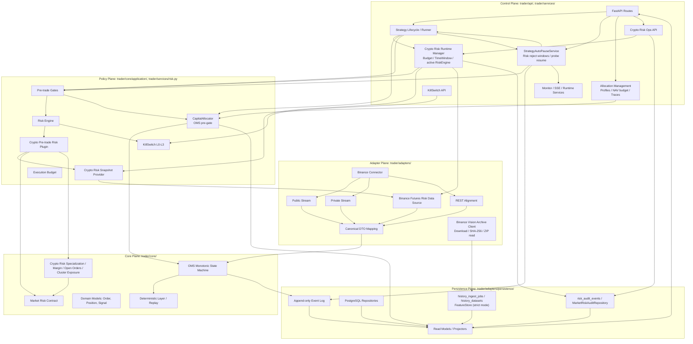

### 层级约束

| 层 | 核心职责 | 禁止事项 |
|----|----------|----------|
| Core | 订单状态机、确定性回放、领域模型 | IO、网络、DB、环境变量、交易所原始字段 |
| Adapter | 外部 IO、字段清洗、REST/WS 对齐、脏数据隔离 | 直接修改 Core 内部状态、Public/Private Stream 共享状态 |
| Persistence | Event Sourcing、PG 仓储、投影读模型 | 绕过事件语义覆盖真相源 |
| Policy | 风险决策、KillSwitch、预算/余额 gate | Fail-open、绕过风险决策下单 |
| Control | API、生命周期管理、监控聚合、人工控制入口 | 绕过 Risk/Policy/Core 直连交易 |

---

## 2. 主数据流

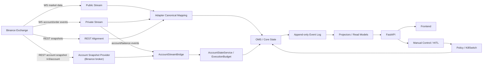

### 数据流规则

- WS 负责低延迟驱动，REST 负责最终一致性校准。
- REST Alignment 的 public 自检与时间同步必须复用统一 proxy failover；主代理不可达时需在本次请求内重试备代理，不能把单次代理连接失败误判为交易所 REST 整体不可用。
- Adapter 将外部字段转换为内部标准字段，Core 不接收交易所原始 payload。
- `AccountStreamBridge` 汇总 Private Stream account/balance 事件和 REST `/v3/account` 快照，写入 `AccountStateService` 并驱动 `ExecutionBudget`；REST 账户快照 provider 必须来自具备账户读取能力的 broker/account provider，不得假定 `BinanceConnector` 暴露账户读取私有方法。
- Event Log 是状态回放真相源，读模型只是投影。
- 控制面操作必须经过 Policy / KillSwitch，不得绕过 Core 状态机。

---

## 3. 策略到下单闭环

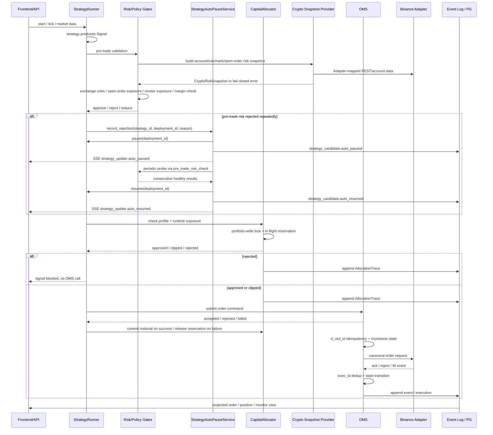

### 闭环不变性

- 下单前必须经过风险、余额、预算、KillSwitch 和 CapitalAllocator gate。
- 自动暂停只处理“同一策略运行实例被风控反复拒绝”的休眠/恢复体验，不改变 KillSwitch、RiskEngine 或 Fail-Closed 的判定优先级。
- 开仓信号在 OMS callback 前必须按 `deployment_id` 读取最新 allocation profile；`REJECTED` 不得调用 OMS，`CLIPPED` 必须修改 `Signal.quantity` 后再进入 OMS。
- allocation profile 的比例预算只能在 Control Plane 解析为 `effective_max_notional` 后进入 Policy Plane；前端计算值仅作展示，不得作为 OMS 前置执行依据。
- CapitalAllocator 的 OMS 前 reservation 只存在于进程内，不得提前增加 `StrategyAllocationProfile.current_notional`；只有 OMS callback 返回 truthy 后，才提交 committed exposure 并更新 `current_notional`。
- Allocation reservation 使用 portfolio-wide 锁；同一运行进程内所有 symbol 的分配检查、预留、提交和释放串行化，避免跨 symbol 并发穿透组合级预算或净敞口限制。
- OMS 返回 falsy 或抛异常时只释放 in-flight reservation，不得减少已有 committed notional。
- 订单幂等主键是 `cl_ord_id`；成交幂等键是 `cl_ord_id + exec_id`。
- 终态订单不得回退。
- Broker 异常必须按业务拒单和网络不确定性区分处理。

### Crypto 独立风控补充

- `MarketRiskSnapshot`、`MarketInstrumentSpec`、`MarketRiskBudget` 和 `MarketRiskAuditEvent` 是 Core / Policy / Persistence 的市场无关风险契约；Crypto 风控继续保留为 specialization，通过转换方法投影到通用契约。
- 策略只提交 `Signal` / trade intent；最终放行、拒绝、缩量建议和 KillSwitch 建议由 Policy Plane 决定。
- `CryptoPreTradeRiskPlugin` 通过 `CryptoRiskSnapshot` 读取账户、规则、mark price、在途订单、持仓和风险预算；`DataSourceCryptoRiskSnapshotProvider` 位于 Service 层，调用 Adapter 边界清洗后的 `CryptoRiskDataSource` 构建快照，Core 计算保持无 IO。
- `trader/api/crypto_risk_runtime.py` 位于 Control Plane，解析 `CRYPTO_RISK_*` 环境配置，默认关闭；显式启用时由 lifespan 创建 Binance USD-M source、snapshot provider 和 active `RiskEngine`，并把 `pre_trade_risk_check` late-bind 到 OMS。
- 当 `CRYPTO_RISK_ENABLED=true` 但凭证缺失、配置非法或 runtime wiring 失败时，Control Plane 会注入 fail-closed risk check，后续 OMS 下单必须拒绝而不是绕过独立风控。
- `GET /v1/risk/crypto/runtime` 暴露 runtime 状态；`PATCH /v1/risk/crypto/budget` 仅热更新 `CryptoRiskBudget` 并重建 snapshot provider / pre-trade check，不重新创建 Binance source 或泄露凭证。
- `GET/PUT /v1/risk/time-window/config` 读写 `CryptoRiskRuntimeManager` 的时间窗口配置；runtime wired 时 PUT 直接更新 active `RiskEngine`，已注入 OMS 的 pre-trade 回调会立即使用新窗口。
- 每次预算热更新成功后写入控制面事件流 `risk:crypto` / `crypto_risk.budget_updated`；专用审计查询与通用 `/v1/events` 共用同一来源，便于回放与运维追踪。
- `POST /v1/risk/crypto/probe` 是 Control Plane 的只读 readiness probe；它复用已 wired 的 USD-M 风控 source 读取账户风险、mark price、交易规则、杠杆分层、持仓、在途订单和 venue health，并写入 `risk:crypto` / `crypto_risk.probe_run` 审计事件。
- `MarketRiskAuditRepository` 负责 PG-first 风险审计持久化；`risk:crypto` 通过 `risk_audit_events` 的 `stream_key` 过滤展示，同时保留控制面内存事件投影作为 PG 不可用时的回退和旧 `/v1/events` 兼容视图。
- Runtime 注入 OMS 的 crypto `pre_trade_risk_check` 会由 Control/Service wrapper 增补拒绝审计；当风控结果为拒绝或风控回调异常时，写入 `risk:crypto` / `crypto_risk.pre_trade_rejected`，但不改变 Core plugin 的无 IO 边界，也不让审计故障覆盖原始 fail-closed 决策。
- `decision_trace_id` 是业务决策链路 ID；crypto budget/probe/pre-trade 审计会把它写入 `MarketRiskAuditEvent.trace_id` 与 payload，`GET /v1/risk/crypto/audit` 可按 `trace_id` 或 `signal_id` 查询 PG-first evidence。
- 当前执行适配器仍是 Binance Spot Demo 路径；`execution_env=demo` 反映实际执行环境，USD-M source 的 `mode` 仅描述只读风控数据源 URL，不代表 Futures 下单能力。
- Frontend `/crypto-risk` 运维页通过 `GET /v1/risk/crypto/runtime`、`PATCH /v1/risk/crypto/budget`、`POST /v1/risk/crypto/probe` 和 `/v1/events?stream_key=risk:crypto` 完成状态查看、预算热更新、只读联通性检查与审计追踪。
- `BinanceFuturesRiskDataSource` 位于 Adapter 层，只在该层处理 `clientOrderId`、`positionAmt`、`markPrice`、`notionalCap` 等 Binance 原始字段，并在进入 Service 前转换为内部 DTO。
- `ExchangeRuleGuard`、`OpenOrderExposureCalculator`、`PortfolioExposureAggregator`、`PortfolioRiskEnhancementService`、`MarginRiskCalculator`、`IntradayRiskMonitor` 均位于 Core domain service，负责交易所规则、在途订单最坏占用、组合级 group/cluster 敞口、deterministic stress risk、合约保证金和盘中风险事件纯计算；`MarginRiskCalculator` 与 `IntradayRiskMonitor` 保持 crypto/futures 专用。
- `CryptoRiskBudget` 支持 `symbol_clusters` 与 `cluster_notional_caps`；cluster 风险按"已成交持仓 + active open orders + 本次拟下单"聚合，命中 cap 时由 Policy Plane 拒绝，不修改 OMS 状态。
- 在途 `reduce_only` 订单不得提前释放风险预算；只有成交事件进入账本后才减少真实风险。
- OMS 下单入口可注入独立 `pre_trade_risk_check` 回调；该回调拒绝或异常时必须在 broker `place_order` 之前阻断订单。
- `IntradayRiskMonitor` 位于 Core 层，只消费显式传入的 mark price、open order count、WS silence 秒数、margin ratio 输入、drawdown 与 liquidation buffer；检测到风险后通过 `RiskModeController.escalate_to()` 单调升级。真实 WS/MonitorService 调度属于 Service/Control 层，禁止 Core 直接拉取 IO。
- `PortfolioRiskEnhancementService` 位于 Core 层，只消费显式 positions、mark_prices、symbol_clusters 与可选 volatility；压力场景按方向敏感 PnL 计算，集中度按 symbol/cluster/direction 聚合，回测与实盘必须复用同一服务。

### Funding/OI 历史窗口风控补充

- P4.6 新增 Funding/OI 历史窗口派生能力，由 Core 纯计算 + Service 层 Provider 组成。
- Core 层 `FundingOIWindowCalculator` 位于 `trader/core/domain/services/funding_oi_window_calculator.py`，无任何 IO 操作。
- Service 层 `FundingOIMetricsProvider` 位于 `trader/services/funding_oi_metrics_provider.py`，通过 `FundingOIHistoryPort` 和 `CurrentFundingOIPort` 从 FeatureStore 读取历史数据。
- Service 层 `BinanceFundingOIMetricsSource` 位于 `trader/services/crypto_risk_snapshot.py`，通过 `BinanceCurrentFundingOISource` 实时拉取当前 funding rate 和 OI。
- `CryptoFundingOIRiskMetrics` 支持 funding 和 OI 独立计算，包含独立缺失标志：`funding_data_stale`、`oi_data_stale`、`funding_window_insufficient`、`oi_window_insufficient`、`funding_current_missing`、`oi_current_missing`。
- 缺 funding 不影响 OI 指标，缺 OI 不影响 funding 指标。
- 当前值缺失时返回 `None`，并设置对应 `_missing` 标志，不转成 `0.0` 制造虚假 Z-Score。
- `open_interest_change_rate` 为百分比变化率 `(current_oi - mean) / mean * 100`，不是 Z-Score。
- 历史窗口缺失时返回空列表，由 calculator 设置 `window_insufficient` 标志，不伪造历史。
- 运行时环境变量（`CRYPTO_RISK_MAX_ABS_FUNDING_RATE_Z_SCORE` 等）待 P4.8 接入 `CryptoPreTradeRiskPlugin`。

### Live Funding/OI 数据链路

```
DataSourceCryptoRiskSnapshotProvider
    └── FundingOIMetricsPort (Protocol)
            └── BinanceFundingOIMetricsSource
                    └── BinanceCurrentFundingOISource (Adapter)
                            ├── get_current_funding_rate()  → REST /fapi/v1/fundingRate
                            ├── get_current_open_interest() → REST /fapi/v1/openInterest
                            ├── get_latest_funding_ts_ms()  → REST /fapi/v1/fundingRate
                            └── get_latest_oi_ts_ms_ms()     → REST /fapi/v1/openInterest

BinanceCurrentFundingOISource (Adapter 层) 位于:
  trader/adapters/binance/funding_oi_stream.py

BinanceFundingOIMetricsSource (Service 层) 位于:
  trader/services/crypto_risk_snapshot.py
```

### 回测市场无关补充

- `VectorBTAdapter` 通过 `DataProviderPort` 获取历史 K 线；Binance 历史数据源只作为默认装配，A 股或其他市场数据源应在 Service/Adapter 层注入。
- 回测执行成本、交易时段、T+1、涨跌停和 lot 约束不得写死在 engine 内，应通过市场规则或执行模型 specialization 接入。
- Control Plane 的 `/v1/backtests` 统一入口支持 `engine=strategy_runner|vectorbt`。前端 Backtests 页面通过同一 DTO 选择引擎；Service 层负责将已加载的 `StrategyRunner` 策略桥接为 VectorBT signal 序列。
- `engine=vectorbt` 在 `data_mode=dev_smoke` 下使用确定性 OHLCV provider 做无网络烟测；`data_mode=real_feature_store` 通过 `FeatureStoreOHLCVDataProvider` 按 `feature_version` 读取 FeatureStore OHLCV，缺数据时不得回退为 synthetic 数据。
- Control Plane 的 `/v1/data/catalog`、`/v1/data/ohlcv/coverage` 和 `/v1/data/ohlcv/import` 是当前研究数据入口；前端 Data 页面通过这些接口导入版本化 OHLCV、查看 `symbol + feature_version` 覆盖、最新时间戳和数据质量。
- `/v1/data/ohlcv/import` 写入 `feature_name=ohlcv` 的 compact dict，后续 `real_feature_store` 回测通过同一 FeatureStore 读取，避免 Data 页面和 Backtests 使用两套数据真相源。
- `BinanceOHLCVRestSource` 位于 Adapter 层，负责调用 Binance REST `/v3/klines` 并把原始数组映射为内部 OHLCV bar；`BinanceOHLCVIngestionWorker` 位于 Service 层，负责分页、断点续拉、幂等写入 FeatureStore。
- `POST /v1/data/ohlcv/sync-binance` 提供单次补数；`/v1/data/ohlcv/worker/start|stop|status` 控制持续 worker。默认不自动启动，只有 `BINANCE_OHLCV_INGESTION_ENABLED=true` 时由 lifespan 启动。

### 历史归档数据通路（Binance Vision → 真实回测）


- Adapter Plane 新增 `trader/adapters/market_data/binance_vision.py`：固定币安公开归档 URL、流式下载到临时文件、
  计算 SHA-256、比对官方 `.CHECKSUM`、校验通过后原子提交到 `MARKET_DATA_ROOT` 下的**版本化**路径
  （不覆盖被已发布数据集引用的文件，官方修订产生新版本，旧版本保留）。
- Core Plane 新增 `trader/core/domain/services/ohlcv_archive.py`：纯函数领域服务，负责时间戳解析
  （2025-01-01 起微秒，之前毫秒）、K 线数值 / 对齐校验、月度覆盖度与缺口 / 冲突检测。**禁止 IO**。
- Persistence Plane 新增 `history_ingest_jobs` / `history_datasets` 两张表（迁移 `009_history_datasets.sql`），
  并为 `FeatureStore` 增加**严格模式**（PG 不可用 / 读写失败一律抛错，绝不回退内存）。
- Service 层 `HistoryIngestionService` 负责任务编排（`QUEUED → RUNNING → SUCCEEDED/FAILED`、
  阶段推进、原子领取、启动恢复、失败重试），`HistoryJobWorker` 是**单并发**后台 worker，由 API lifespan 管理。
- Control Plane 的 `/v1/data/history/*` 与 `/v1/backtests` 共用同一套异步准入校验：
  `BacktestService.resolve_backtest_request()` 先校验数据集再创建回测，**不依赖前端禁用按钮**。
- 真实历史回测只支持**单币对**，禁止 `symbols[0]` 静默丢弃其它币对；执行阶段 Provider 会再次核验
  market / interval / 质量与真实读取完整性。
- 旧入口（`POST /v1/data/ohlcv/import` 手动导入、`/v1/data/ohlcv/worker/*` 实时 worker）保留为高级入口，语义不变。

### 历史归档 → Research 数据集通路（Binance Vision → 事件回测）

在上面的旧 vectorbt 通路之外，新 Research 平面有一条独立通路：

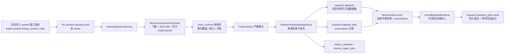

- 新增 `trader/trading/research_bridge.py`：归档 K 线到 `BAR_V1` 的**纯函数**投影
  （整数毫秒、`close = available_at = open + 60000`、十进制字符串、版本由归档摘要派生）。
- 新增 `trader/adapters/persistence/research_history_bridge_store.py`：把 Research 数据集、
  provenance 关联、历史数据集与历史任务在**同一个 PostgreSQL 事务**内发布，失败整体回滚。
- 新增 `research.dataset_links`（迁移 `010_research_dataset_links.sql`）：只保存来源证据
  （URL、官方/实际 SHA、归档版本、UTC 覆盖、质量、转换版本、provenance 哈希），**不重复存行情**。
- 新增 `research.datasets.metadata` 列：目录接口只读元数据，避免加载行情载荷。
- 历史导入改为**独立进程** `trader/runtime/history_worker_main`：
  - PostgreSQL session advisory lock 保证同库单 owner；
  - 只有 owner 执行启动恢复，且恢复成功前不领取任务；
  - 旧 API 的内嵌 worker 默认关闭（`QTS_ENABLE_EMBEDDED_HISTORY_WORKER=1` 可打开）。
- 新 Control API 承载 `/v1/data/history/*` 与 `/v1/research/*`；`/v1/research/datasets` 是**元数据目录**，
  `/v1/research/strategies` 列出允许提交的已安装策略。
- `FAILED` 的回测任务是终态：claim 只取 `QUEUED` 或租约过期的 `RUNNING`，
  重试必须显式调用 `POST /v1/research/backtests/{run_id}/retry`（保留 run id、冻结 manifest 与哈希）。
- 阶段 4 起同一入口支持**联合回测**：manifest 可用 `strategies` + `book_allocations` 描述多个策略，
  共享一个账户现金、按 `book:{strategy_id}` 隔离资金与持仓。`ResearchExecutor` 在独立 Worker 进程中
  为每个策略/标的创建独立插件，复用 `EventBacktestRuntime` 与共享 `core` 经济函数；结果逐 book
  导出权益、预算占用与手续费，并保留 dataset/provenance/runtime 版本链。Research Worker 只连接
  Research 存储，不读取实盘账户状态，也不具备交易所发送能力。
- 补录命令 `scripts/backfill_research_dataset_links.py` 默认 dry-run，
  为桥接之前就已发布的历史数据集补登 Research 数据集与 provenance（官方修订报冲突，不覆盖既有 ID）。

### Research / Fast Backtest / Risk Replay 三层收敛

当前研究与回测体系分为三层，不再把单一外部框架描述为“唯一主引擎”：

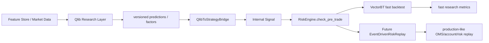

边界定义：
- Qlib 只属于 Research/Insight 域，用于因子、模型、预测和研究组合输出。
- Qlib 输出必须先转换为内部 `Signal`，再进入 `RiskEngine.check_pre_trade()`；禁止 Qlib 直接生成订单或绕过风控。
- VectorBT 是当前已实现的快速向量化回测引擎，负责快速验证和风控后权益曲线，不承担完整实盘撮合回放语义。
- Backtests API 已将 VectorBT 接入主回测入口，产出统一的 `BacktestRun` / `BacktestReport`；报告 metrics 中必须标记 `backtest_engine=vectorbt`、`backtest_data_mode` 和 `data_quality_summary`，供门禁区分研究级真实回测和开发烟测。
- `EventDrivenRiskReplay` 已实现（P9.4），用于更接近实盘的订单、账户、风控、OMS 事件回放。
- QuantConnect Lean 相关运行时代码已清理；历史选型背景仅保留在 ADR/比较文档中，不再是当前 active engine。

### P9 市场规则插件架构

P9 将跨市场规则拆成“市场无关接口”和“市场专用插件”两层：

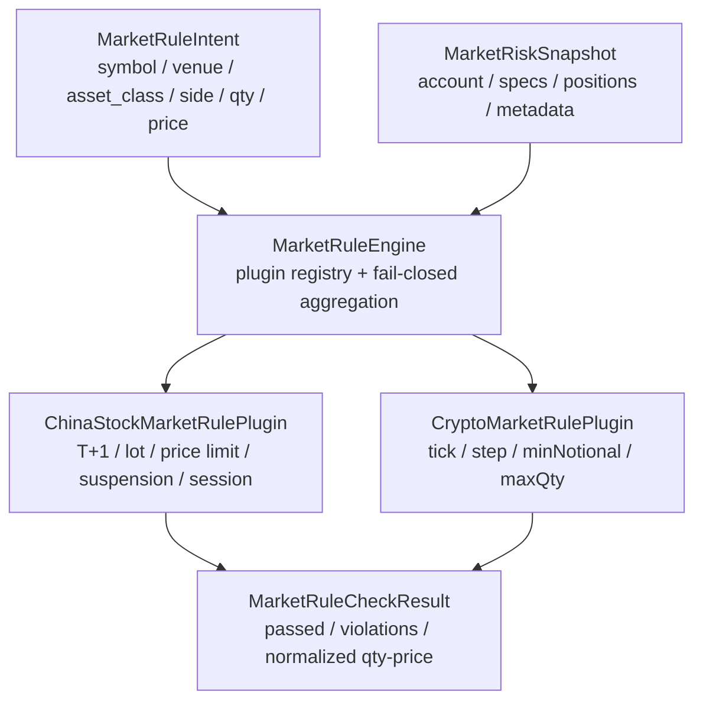

架构边界：
- `MarketRuleEngine` 只负责插件调度、结果聚合和异常 fail-closed，不包含任何 A 股或 Binance 专属规则。
- T+1、100 股、涨跌停、停牌、不可做空、午休/集合竞价只属于 `ChinaStockMarketRulePlugin`。
- tick、step、minNotional、maxQty 只属于 crypto specialization，可优先包装现有 `ExchangeRuleGuard`。
- 市场专属输入通过 `metadata` 或 specialization DTO 承载，不反向污染 `MarketRuleIntent` / `MarketRiskSnapshot` 通用字段。

### P7 回测风控集成路径

回测层通过 `BacktestRiskIntegration` 接入真实风控，支持三种 `risk_mode`：

- `raw_only`: 纯策略信号回测，不经过风控引擎
- `risk_adjusted`: 使用 `VectorBTAdapterWithRisk` 进行风控调整后回测
- `event_replay`: 使用 `EventDrivenRiskReplay` 逐信号风控回放

`risk_mode` 由前端 `Backtests.tsx` 下拉选择，通过 `BacktestDatasetSpec.risk_mode` 提交到后端，最终写入 `BacktestRequest.risk_mode`。

回测分为订单入队路径和 VectorBT 风控后权益曲线路径：

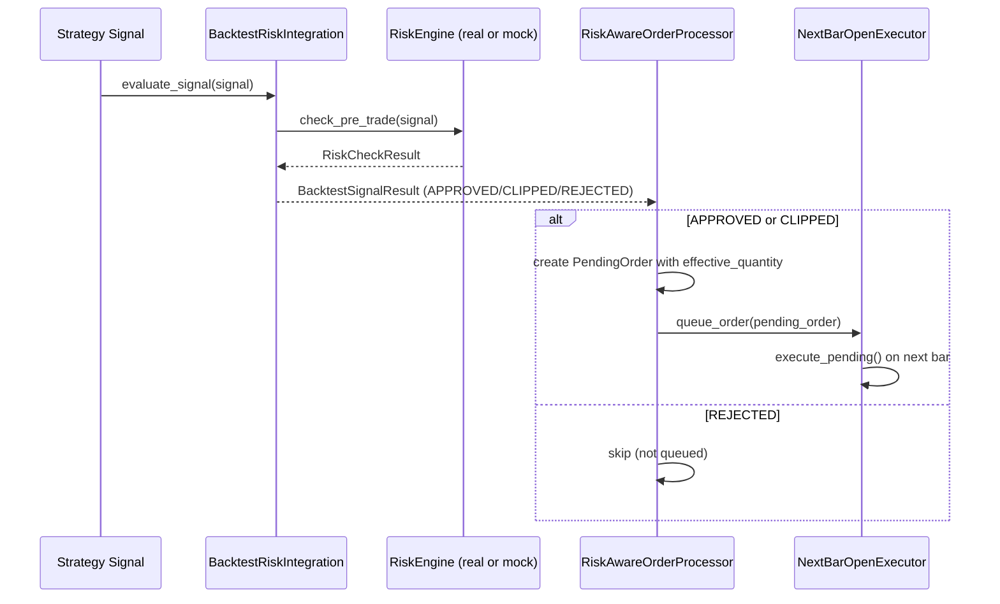

关键约束：
- `BacktestRiskIntegration` 通过 `risk_engine.check_pre_trade()` 调用完整风控，不绕过 RiskEngine
- `BacktestRiskEnginePort` Protocol 支持注入模拟 RiskEngine（回测）或真实 RiskEngine（生产）
- `RiskAwareOrderProcessor` 将 APPROVED/CLIPPED 结果转换为 `PendingOrder` 并加入执行器队列
- REJECTED 信号不进入执行器队列，不进入成交模拟
- CLIPPED 信号使用 `max_allowed_qty` 作为 `effective_quantity`

VectorBT 路径由 `VectorBTAdapterWithRisk` 负责：

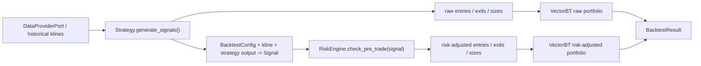

关键约束：
- VectorBT 风控路径不得硬编码 symbol、price 或 quantity；必须使用 `BacktestConfig`、K 线价格和策略显式输出
- REJECTED 信号在风控后输入序列中写为 `entry=False`、`exit=False`、`size=0`
- CLIPPED 信号必须把 `effective_quantity` 写入 VectorBT `size`，让风控后权益曲线真实改变
- `BacktestResult.max_drawdown` 保持原始含义，风控后回撤写入 `max_drawdown_after_risk` 和 `risk_adjusted_metrics`

### P8 Demo Fail-Closed 演练路径

P8 演练由只读脚本验证运行时坏情况，不触发交易所下单：

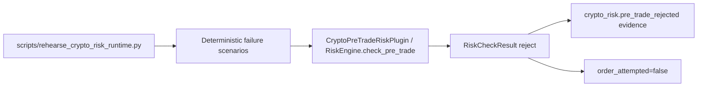

场景覆盖 mark price 缺失、leverage bracket 缺失、open orders 激增、Funding/OI 数据过期、Binance source 超时、连续重复信号、close-only 模式开仓信号和 PG audit 不可用。除 PG audit 不可用场景外，所有拒绝都必须产生审计事件；PG audit 不可用场景用于证明审计写入失败不会导致订单放行。

---

## 4. 对账与恢复闭环

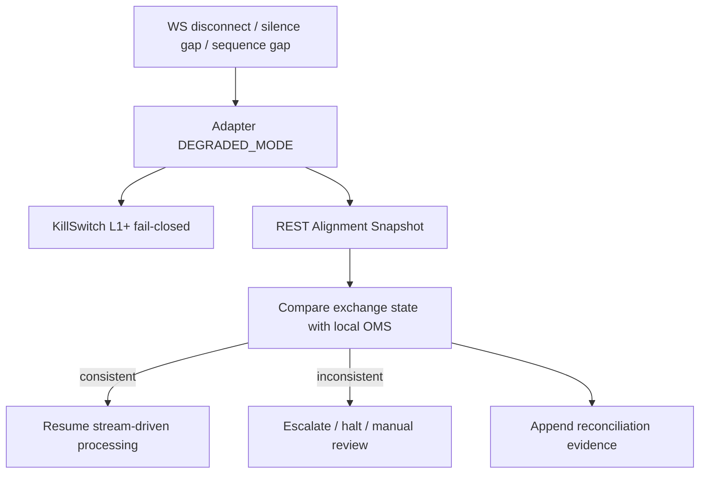

### 恢复规则

- WS 断线、静默、序列跳变后必须先 REST Alignment。
- 无法解释的不一致必须 fail-closed，并升级 KillSwitch。
- 对账证据必须可追踪，不能用 `except: pass` 静默吞错。

---

## 5. 文档与契约关系

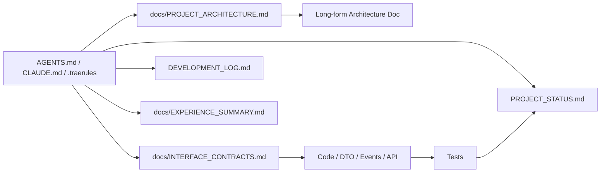

### 文档分工

| 文档 | 职责 |
|------|------|
| `docs/PROJECT_ARCHITECTURE.md` | 当前架构图、主数据流、闭环拓扑、架构更新触发条件 |
| `docs/quant_trading_system Crypto v3.4.0_Architecture.md` | 长篇架构原则、阶段能力说明、背景解释 |
| `docs/INTERFACE_CONTRACTS.md` | 命名、DTO、事件 Schema、跨层接口契约 |
| `PROJECT_STATUS.md` | 当前状态和最近任务结果 |
| `DEVELOPMENT_LOG.md` | 只追加的开发过程记录 |
| `docs/EXPERIENCE_SUMMARY.md` | 踩坑、模式、可复用经验 |

---

## 5.1 风控闭环链路（阶段0新增）

阶段0锁定了三条核心风控闭环，后续所有开发必须围绕这三条链路展开。

### 5.1.1 RiskSizing 裁剪链路

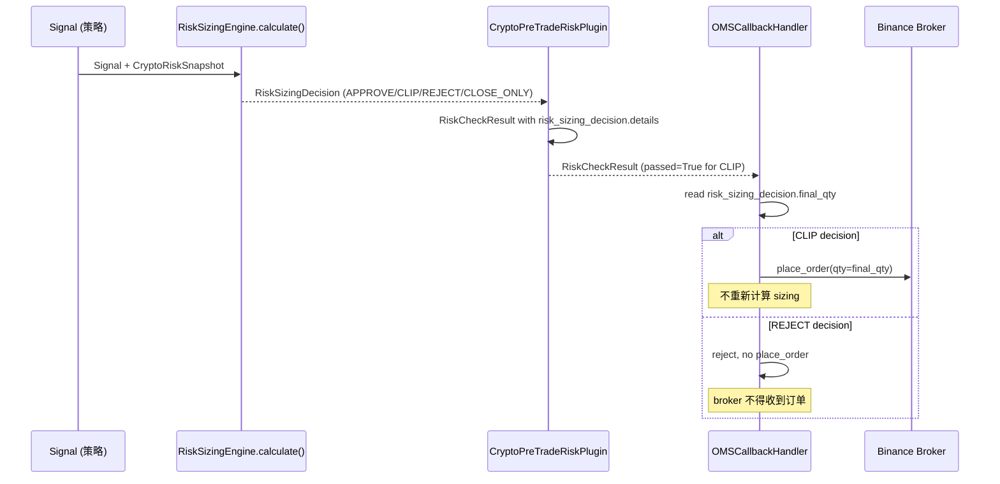

**关键约束**：
- `RiskSizingEngine.calculate()` 位于 Core domain service，输出 `RiskSizingDecision`
- `CLIP` 时 OMS **必须**使用 `final_qty`，不得使用 `requested_qty` 或 `normalized_qty`
- OMS 不得重新计算 sizing，只能消费核心层决策
- 审计必须记录 `requested_qty`、`normalized_qty`、`final_qty`、`limiting_factor`
- `final_qty <= 0` 或缺失时，OMS 必须 fail-closed 返回 REJECT

### 5.1.2 RiskMode/KillSwitch 控制链路

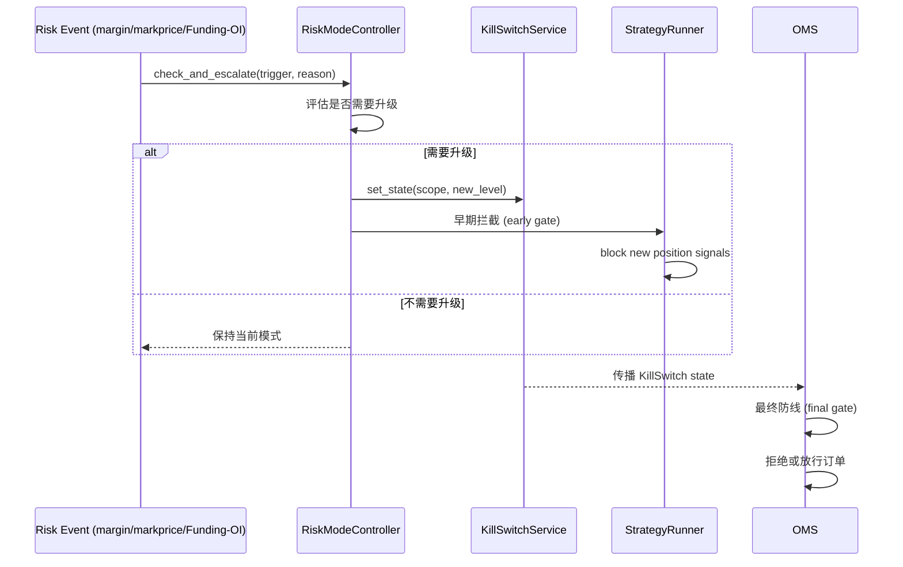

**RiskMode 动作矩阵（区分三种命令）**：

| RiskMode | place_order (新下单) | cancel_order / cancel_all | reduce_only liquidation |
|----------|---------------------|---------------------------|------------------------|
| NORMAL | ✅ 允许 | ✅ 允许 | ✅ 允许 |
| NO_NEW_POSITIONS | ❌ 禁止新开仓 | ✅ 允许 | ✅ 允许 |
| CLOSE_ONLY | ❌ 禁止新开仓 | ✅ 允许（撤销现有挂单） | ✅ 允许 |
| CANCEL_ALL_AND_HALT | ❌ 禁止所有下单 | ✅ **必须执行** cancel_all | ✅ 允许（系统强平 actor） |
| LIQUIDATE_AND_DISCONNECT | ❌ 禁止策略订单 | ❌ 禁止 | ✅ **系统强平 actor 允许** |

**关键约束**：
- `CANCEL_ALL_AND_HALT` 必须先执行 `cancel_all`，再阻止新下单
- `LIQUIDATE_AND_DISCONNECT` 禁止策略订单，但允许系统强平 actor 发出 `reduce_only` 强平单
- StrategyRunner 是早期拦截点，OMS 是最终防线
- KillSwitch 和 RiskMode 不得有两套互相矛盾的等级语义

### 5.1.3 Funding/OI 生产数据链路

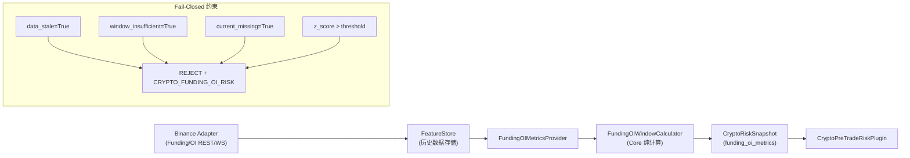

**数据源契约**：

| 数据源 | Freshness 要求 | fail-closed 行为 |
|--------|----------------|------------------|
| 历史 Funding Rate | 必须覆盖 `funding_history_window` 天数 | 窗口不足时 REJECT |
| 历史 OI | 必须覆盖 `oi_history_window` 天数 | 窗口不足时 REJECT |
| 当前 Funding Rate | 必须返回最新值 | 缺失时 REJECT（阈值启用时） |
| 当前 OI | 必须返回最新值 | 缺失时 REJECT（阈值启用时） |

**关键约束**：
- funding 和 OI **独立计算**，互不影响
- `None` 不得转成 `0.0` 制造虚假 Z-Score
- Adapter/Service 层读取数据，Core 层只消费 snapshot
- 单测不得访问真实网络，必须用 fake provider

---

## 6. 研究到自动组合运行闭环

```mermaid
flowchart LR
    Data["Crypto Core Data Sources"] --> BinanceSource["Binance OHLCV REST Source"]
    BinanceSource --> Ingestion["OHLCV Ingestion Worker"]
    Ingestion --> FeatureStore["FeatureStore / feature_version"]
    Data --> DataAPI["Data Catalog / OHLCV Import API"]
    DataAPI --> FeatureStore
    FeatureStore --> Candidate["StrategyCandidate Lifecycle"]
    Candidate --> Debug["Code Debug Gate"]
    Debug --> Backtest["Backtest Dataset + Report"]
    Backtest --> Validation["Validation Gate"]
    Validation --> Promote["Promote to Deployment"]
    Promote --> Allocation["Capital Allocation / RiskSizer"]
    Allocation --> Runtime["Paper/Shadow Runtime"]
    Runtime --> Autopilot["Portfolio Runtime Controller"]
    Autopilot -->|"START/PAUSE/STOP/REDUCE"| Runtime
    Autopilot --> Audit["Audit / Replay Events"]
```

### 闭环规则

- `candidate_id` 管策略研究生命周期，`strategy_id` 管策略模板，`deployment_id` 管运行实例，三者不得混用。
- 回测必须显式记录 `feature_version` 和 `data_mode`；成功回测可推进候选到 `BACKTEST_PASSED` 以完成前端闭环，但 `dev_smoke`、`raw_only` 只能用于开发烟测，必须在 validation 阶段拒绝部署准入。
- Data 页面不得静态伪造 FeatureStore 覆盖；`feature_store_ohlcv` 必须来自 FeatureStore 聚合查询，缺数据时显示 missing/empty coverage。
- 研究级 VectorBT 回测和 Data 页面必须共享同一个 `feature_version` 语义，导入、覆盖查询、回测报告和审计中的版本名必须一致。
- Binance OHLCV worker 只写研究数据，不下单、不调用 OMS、不改变策略运行状态；遇到 FeatureStore key 冲突时不得覆盖旧值，只记录 conflicts 和 last_error。
- 策略信号进入 OMS 前必须经过仓位分配与风险裁剪，分配结果写入 `AllocationTrace`。
- `PERCENT_OF_NAV` allocation profile 的 `paper_nav` 来源属于 Control Plane 写入校验：先读内存 NAV series，缺失时读 `nav_points` PostgreSQL 持久化读模型，仍缺失则 fail-closed 返回 422。
- 前端 Portfolio Allocation 新建 profile 默认 long-only，`allow_short=true` 只能来自用户显式勾选。
- Portfolio Runtime Controller 第一版面向 paper/shadow 自动运行，所有启停/降仓决策写入审计事件。

---

## 6.1 Performance Benchmark Projector 数据流

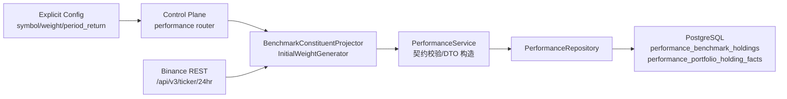

**边界约束**：

- `trader.api.trading_app.create_trading_app()` 必须挂载 `trader.api.routes.performance.router`，Control Plane 端点不能只存在于孤立 route module。
- Binance ticker 读取属于 Adapter/Service 边界 IO；Core domain models 只保存标准字段 `symbol`、`weight`、`period_return`、`metadata`。
- `BenchmarkHolding` 写入幂等键为 `(benchmark_id, symbol, period_start_ms, period_end_ms)`；`PortfolioHoldingFact` 写入幂等键为 `(run_id, symbol, period_start_ms, period_end_ms)`。
- 显式 config 中的 `constituents[].period_return` 必须按 symbol 传递到 persistence，用于后续 Brinson/归因计算；全局 `period_return` 只作为默认值。

## 6.2 Performance Execution Projection 数据流

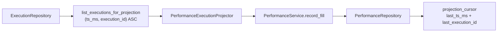

**边界约束**：

- Execution projection 是 Persistence -> Service 的只读投影链路，不得改变 OMS/event sourcing 真理来源。
- `list_executions_for_projection()` 必须在内存和 PostgreSQL 实现中按 `(ts_ms, execution_id)` 升序过滤、排序和 `LIMIT`，避免历史积压超过 batch size 时跳过旧 execution facts。
- `PerformanceExecutionProjector` 只能根据成功投影的 execution 推进 cursor；失败时停止当前 batch，保留未处理记录供下一轮重试。

---

## 7. 架构变更更新规则

以下情况必须更新本文档：

1. 新增、删除或重命名关键模块、服务、平面职责。
2. 改变 Core / Adapter / Persistence / Policy / Control 任一层边界。
3. 改变订单、成交、风控、对账、恢复、持久化主数据流。
4. 改变 Event Log、PG 仓储、投影读模型的责任分工。
5. 改变 KillSwitch、Risk Gate、Execution Budget 的调用顺序或失效语义。
6. 改变前后端 API 的主链路或部署/运行拓扑。

更新顺序：

1. 先更新 `docs/PROJECT_ARCHITECTURE.md` 中受影响图和约束。
2. 如果涉及接口、DTO、事件或字段命名，同步更新 `docs/INTERFACE_CONTRACTS.md`。
3. 修改实现和测试，遵循 TDD Red → Green → Refactor。
4. 按规则更新 `PROJECT_STATUS.md`、`DEVELOPMENT_LOG.md`、`docs/EXPERIENCE_SUMMARY.md`。
5. 如改变阶段目标、优先级或当前执行入口，同步更新 `docs/PLAN.md` 或阶段计划文档。

---

## 8. Unified Spot Trading Runtime 拓扑

首期 Binance 现货闭环采用三进程、PostgreSQL 协调架构，不引入消息中间件。

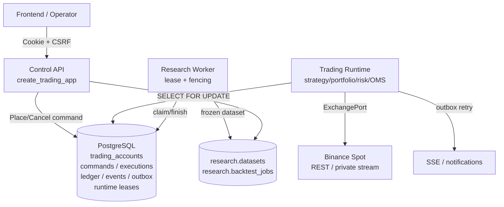

**启动顺序**：

1. 存储初始化（版本化 schema）。
2. 构建 `TradingService`（统一账本、预约、风控、OMS）。
3. 注入 `ExchangePort`（Binance adapter）。
4. 拉取完整 `ReconcileSnapshot` 并恢复（成交/订单/余额/代际）。
5. 获取账户执行租约；冲突则交易未就绪。
6. `/health/trading` 返回 200 后才允许策略启动。
7. 策略预热：重新采集已收盘行情回放插件，重建指标状态；预热完成前策略不产生
   可交易输出，预热失败关闭新增风险。
8. 策略运行；所有新风险命令经过同一 service 入口。

**边界**：

- `trader/trading/` 是纯领域 + 应用事务核心；网络调用只发生在账户事务之外。
- `trader/adapters/broker/spot_execution_adapter.py` 只做 Binance 字段到内部 DTO 的转换；不得修改本地订单/账本。
- `trader/services/trading_ingress.py` 将 private stream 成交与订单更新转发给统一 service；不维护第二套订单状态。
- `trader/api/routes/trading.py` / `research.py` 是控制面入口，不直接触达交易所或账本表。
- `trading_runtime_leases` 保证同一账户只有一个执行实例；研究任务租约与 fencing 独立。
- 已装配 Runtime 的 API 写命令通过 Runtime 入口检查账户执行所有权；Runtime 包装的
  ExchangePort 在网络调用前再次通过 owner/token 续租验证。租约失效立即关闭本实例
  ready/started，存储校验失败拒绝发送；持有效租约仍可在账户风控阻断时撤单。
  已在途请求无法通过本地租约撤回，仍须保留 UNKNOWN 并对账。
- Control API 与 Trading Runtime 可同进程启动用于本地开发，但生产部署按进程拆分。
- 独立运行入口为 `runtime/control_main.py`、`runtime/trading_worker_main.py`、
  `runtime/research_worker_main.py`、`runtime/history_worker_main.py`。
- 历史归档导入进程 `runtime/history_worker_main.py` 用 PostgreSQL session advisory lock 保证同库单 owner；
  只有 owner 执行启动恢复，恢复成功前不领取任务。
- 阶段 6 起 Control API 是唯一 HTTP 进程：前端反代只指向 `QTS_CONTROL_API_TARGET`（默认
  `http://localhost:8090`），不再按路径拆分旧 API。控制面只保存 QUEUED 命令并投递持久
  outbox 到 SSE，不构建 broker；执行器轮询统一账户命令，持租约发送。控制面通过有效 PG
  租约和持久 runtime 元数据读取就绪。旧 `trader/api/main.py` 进程、旧 OMS/ExecutionBudget/
  AccountState 写入路径和旧 StrategyRunner 已删除。
- 真实执行进程缺 private WS 覆盖证明时强制保持阻断，REST 快照不能代替流恢复屏障；
  阶段 6 的真实 Demo 24h 窗口与覆盖/DR 证据以
  `artifacts/foundation/phase6/windows/<run_id>/{window.json,observation.jsonl,dr/}`
  为准；窗口完成前不得宣称 READY，完成后的实际结论以该证据和最新审核为准。
- 执行器将 `PrivateTradingSession` 的世代缓冲、双快照和覆盖门禁装配到 Runtime
  启动、周期对账及主动重连；失联先持久关闭 stream/ready。可选新 `UnifiedStrategyRunner`
  从**已收盘 K 线**生成稳定命令（阶段 3 起不再消费 REST ticker），读取统一账户库存；
  不会进入旧 Runner 的预算/OMS 路径。
- 覆盖证明由 Adapter 侧端口提供（`BinanceSpotCoverageProver`）：以交易所服务器时间
  界定窗口，完整分页回填订单与成交并逐笔映射本系统订单，连续两遍回填一致才返回
  证明；任何不确定性返回 `None` 并保持 `PRIVATE_STREAM_COVERAGE_UNPROVEN`。核心层
  不生成证明，也没有绕过开关。
- 插件指标状态不跨进程持久化：预热窗口在每次进程启动时重新采集（生产实现为 Binance
  已收盘 K 线回放），插件用 `stateful_indicators` / `warmup_events` 声明需求；未声明
  的插件按有状态处理，未配置预热长度即阻断。
- 旧 OMS/ExecutionBudget/AccountState 路径不得与新 service 同时发送订单；切换到新入口时必须以运行时租约和就绪门禁为唯一发送者。

**监控字段**（`GET /v1/trading/metrics`）：

- `unknown_commands`、`unbooked_fills`、`balance_anomalies`、`active_holds`、`reconciliation_age_ms`、`outbox_backlog`、`unresolved`。
- 研究侧：`research.backtest_jobs.status`、`attempt`、`fencing_token`、`lease_until`、`error`。

**运行期对账与恢复边界**：

- 执行租约在恢复之前获取；独立执行进程租约冲突立即退出，不进入对账或发送。
  Runtime 类的受控测试/合并开发入口保留显式后台重试能力。
- 取得租约后完成首次完整对账、补齐 `QUEUED` 命令并进入 `READY`；此后每 `QTS_RECONCILE_INTERVAL_SECONDS` 秒重复完整对账。
- 完整快照必须包含本系统尚未终结的挂单、本系统已关闭订单的终态和最近逐笔成交；仅依赖 `openOrders` 会把已撤/已成交订单误判为未知状态。
- 交易所规则归一化位于 Adapter；MARKET BUY 以 quote 金额结算，成交 base 数量与请求数量不要求相等。
- 主动重连入口只重建 venue 会话；重连后由周期对账恢复 `READY`，不触碰本地账本。

### 8.1 阶段 0 冻结的目标拓扑与责任矩阵（2026-11-02）

本节是阶段 0 对第 8 节的**增量冻结**，不改变第 8 节既有事实。完整依据、验收项与阶段划分见
`docs/FOUNDATION_REFACTOR_PHASE0.md`；接口与数据契约见 `docs/INTERFACE_CONTRACTS.md`
第 13.8（进程责任矩阵）、13.9（`book_id` 数据契约）、13.10（已知契约偏差）与 15.4（基线测试约定）节。

**目标进程 / 端口 / 凭据 / 责任矩阵**：

| 进程 | 入口 | 监听 | 交易所写凭据 | 账户经济状态写入 | 命令 | 事实入口 | 查询 |
|---|---|---|---|---|---|---|---|
| Control API | `trader/runtime/control_main.py` | `QTS_TRADING_API_PORT`，默认 `8090`，默认绑 `127.0.0.1` | **无**（`NoExchangeIO`，`control_main.py:27-32`） | **无**（只落 `QUEUED` 命令与账户内预约，`defer_send=True`，`control_main.py:110-112`） | 受理 PLACE / CANCEL / CONTROL（含 `RESOLVE`） | **无**（阶段 1 已移除公开事实入口） | 命令状态、订单、风险视图、指标、SSE |
| Execution | `trader/runtime/trading_worker_main.py` | 无 HTTP | **有**（缺任一即 `BINANCE_CREDENTIALS_MISSING` 拒绝启动，`trading_worker_main.py:176-181`） | **唯一**（账本 / 持仓 / 预约 / 成交 / 余额） | 消费 `QUEUED` 并发送；持有 `trading_runtime_leases` | **唯一**（REST 对账、WS 成交、订单观测） | 就绪状态、内部指标 |
| Research Worker | `trader/runtime/research_worker_main.py` | 无 | 无 | 无 | 无 | 无 | 发布冻结回测结果（fencing token） |
| History Worker | `trader/runtime/history_worker_main.py` | 无 | 无（只读公开归档） | 无 | 无 | 无 | 导入历史数据集 |
| PostgreSQL | `compose.yml` → `postgres:16` | `5432` | — | 存储 | 协调 | 协调 | 协调 |

- 进程间只通过 PostgreSQL 协调，不引入消息中间件、集群或自动主备。
- Control 进程**永远不持有交易所写凭据**，也不装配任何交易所 IO 端口。
- 账户经济状态的唯一写入者是 Execution 进程；Control 只产生**意图**。
- 旧 `trader/api/main.py`（端口 `8080`）已在阶段 6 删除；原只读查询迁移到 Control API（见 8.5）。

**持久化模型边界（不是完整事件溯源）**：

- 账户快照 `trading_accounts.state`（jsonb）是权威状态，每事务整体覆写；
  `read()` 只读这一列（`trader/trading/postgres.py:203-212`）。
- `trading_executions` / `trading_ledger` / `trading_events` 是**追加事实**，用于审计与重放证据，
  但**无法单独重建**余额、持仓与预约。
- `trading_commands` / `trading_order_projection` 是**可重建查询投影**。
- 因此后续阶段**不引入事件溯源框架、不重写持久化形态**；新增的是账户快照内的字段与投影，
  不是新的真相源。

**阶段 1 已关闭的安全缺陷与旁路（2026-11-02，实现与契约见 `docs/INTERFACE_CONTRACTS.md` 13.11）**：

- 余额差异未解释时**不再覆盖**权威内部余额；交易所余额作为 `reconciliation.venue_balances`
  观测保留，差异经 `AccountRiskView.balance_differences` 与 metrics 可查询。`resolve` 必须携带
  可核对证据，证据一致后以显式 `external_adjustment` 账目结算。
- 存在未决 `UNKNOWN` PLACE 命令时不再发送任何新的 PLACE；新 PLACE 返回
  `UNKNOWN_COMMAND_PENDING`。`UNKNOWN_COMMAND` 按 `command_id` 定向解除，其他命令结果不影响它。
- Control API 不再暴露成交/观测/对账/resolve 事实写入口；操作员差异处理改为 `RESOLVE`
  控制命令，由 Execution 进程校验证据后应用。Control 进程无论环境是否出现凭据都只持久排队。
- 历史存储不可用时研究提交 fail-closed（`HISTORY_STORE_UNAVAILABLE`），不再回退到
  无 eligibility checker 的应用。
- 两处安全基线的 `xfail` 标记已移除，断言转为普通通过；真实验收证据见
  `trader/tests/test_phase0_foundation_safety.py` 与 `trader/tests/test_phase1_foundation_safety.py`。

### 8.2 阶段 2 已实现：统一订单规格与 book 子账簿（2026-11-02）

本节是阶段 2 对第 8 / 8.1 节的增量事实；接口细节见 `docs/INTERFACE_CONTRACTS.md` 13.12，
迁移步骤见 `docs/PHASE2_BOOK_LEDGER_MIGRATION.md`。

**订单规格单入口**

- `trader/trading/order_spec.py` 的 `build_order_spec()` / `OrderSpec.to_command()` 是策略到命令的
  唯一规格路径；`Signal.order_type` 与 `Signal.time_in_force` 显式声明，`signal.metadata` 不再
  提供隐式默认。`validate_order_command()` 在 service 与 Binance adapter 两处校验同一契约。
- LIMIT 价格取信号价；MARKET 参考价及其来源/时点写入 `PlaceOrderCommand`、`order.queued`
  事件和订单查询。当前生产 ticker 输入标为 `MARKET_REFERENCE_TICKER`；closed-bar 替换属阶段 3。

**book 子账簿与双层预约**

- `AccountState.books` 把账户资产稳定分区为 `UNALLOCATED` + `book:{strategy_id}`；
  `trader/trading/books.py` 负责守恒、划拨、归属证据和逐 book 快照。
- 一笔订单在同一账户事务内创建账户层 `state.holds` 与 book 层 `books[book_id].holds`；
  成交按数量释放两层，撤单/拒绝/终态释放剩余预约，任一层失败回滚整个事务。
- 同一 book 同 symbol 的未终结反向订单先拒绝 `BOOK_OPPOSITE_ORDER_IN_FLIGHT`。
  book 预算只来自自身余额与持仓，不借用其他 book 或账户总余额；账户级 `SpotRiskEngine`
  风控仍独立生效。
- `ALLOCATE` 是 Control→PostgreSQL→Execution 的持久幂等命令；`GET /v1/trading/books`
  提供阶段 4 需要的逐 book 权益/预算查询。Control 仍不写账户经济状态。

**归属与迁移**

- 旧快照在 `decode_state()` 中把存量资产放入 `UNALLOCATED`，既有在途订单/预约保守保留并
  标记 `BOOK_ATTRIBUTION_UNKNOWN`；不猜测策略、不清库、不改写旧 ledger/events/订单。
- 归属不明的成交按 `UNALLOCATED` 记账以保持守恒，同时阻断新增风险；只有逐单证据的
  `RESOLVE` 才能解除。旧无 scope `UNKNOWN_COMMAND` 仅在能证明 `command_id` 归属时迁移。
- 新栈准入风控仍只有 `SpotRiskEngine`；执行入口通过 `QTS_RISK_POLICY_JSON` / `QTS_FEE_RATE`
  读取 `RiskPolicy`，未知字段拒绝。旧 `RiskService` 不构成第二套准入。

**结算口径与联合回测（第 2 轮审核修复）**

- `PlaceOrderCommand.settlement` 显式区分结算口径：`QUOTE` 表示交易所按 `qty * price` 的报价
  额度成交（市价买入可换回多于 `qty` 的 base，但报价支出不得超过额度）；`BASE` 表示按请求的
  base 数量成交（历史 bar 模拟器）。LIMIT 边界不变。
- 成交释放两层预约使用真实成交：`qty * execution.price` + 仅 quote 币种的 fee；admission
  `fee_rate` 只是缓冲。quote-settled MARKET BUY 不以 `booked_qty == command.qty` 推断完成，
  只有报价预算耗尽或终态观察/显式终态事实才清真实剩余；LIMIT/BASE 完全成交语义不变。
- 所有生产信号消费者都读取显式 `order_type`：内置 `fire_test` 声明 MARKET；`Signal.to_order_params`
  缺失/非法 fail-closed；旧 OMS `execute_signal` 在 broker/经济副作用前校验，缺失/不支持分别
  稳定拒绝 `ORDER_TYPE_REQUIRED` / `UNSUPPORTED_ORDER_TYPE`，价格不再决定订单类型。旧 OMS
  未接入新服务/账簿，部署拓扑不变。
- 所有业务命令由 `trader/trading/order_spec.py` 统一构造，策略、Control API、回测共用；
  生产代码只允许 `store.decode_state()` 解码持久化命令。
- `EventBacktestRuntime` 支持显式的 `strategy_books`（`strategy_id -> book:{strategy_id}`）与
  `initial_allocations`：多策略联合回测里每个信号按 `strategy_id` 路由到自己的 book，
  预算不足被该 book 拒绝；`BacktestResult.books` 复用 `books.book_snapshot` 输出逐 book
  余额/持仓/预约/可用预算/权益，阶段 4 可直接读取。初始资金分配必须显式，剩余留在
  `UNALLOCATED`，不按策略隐式归集，也不做任何内部撮合或净额。

### 8.3 阶段 3 已实现：closed-bar 决策输入与资格链（2026-11-03）

本节是阶段 3 对第 8 / 8.2 节的增量事实；接口细节见 `docs/INTERFACE_CONTRACTS.md` 13.15。

**执行进程的行情路径**

- `trader/runtime/trading_worker_main.py::feed_market_once` 只调用公开 K 线端点，过滤
  `available_at_ms > 决策时钟` 的未完成 bar；不再装配或调用 `get_ticker_prices`。缺少 K 线
  端口时以 `CLOSED_BAR_SOURCE_REQUIRED` 阻断，不回退 REST 快照。
- 执行进程用 `VenueClock` 把决策时钟锚定到 venue server time，并以独立可注入的单调经过时间
  推进；每次 feed 前重新采样，时间源/单调源失败直接阻断。策略可见性、warmup、对账与 feed
  使用同一 venue 时间域，本地 wall clock 前跳/后跳不会让未收盘 bar 进入策略。
- Binance 含尾 `closeTime` 在 `_kline_observation` 归一化为 BAR_V1 半开区间；真实时钟下
  `timestamp`/`available_at_ms` 均为 bar 收盘时刻，`bar_id` 与 `open_time_ms` 进入观测和命令审计。
- 新栈 `UnifiedStrategyRunner` 只接受完全指定的已收盘 KLINE；TICKER/TRADE/DEPTH/FUNDING/
  INDEX_PRICE/MARK_PRICE 在插件与账户副作用前抛 `NON_BAR_MARKET_DATA`。KLINE 必须具备显式
  open/interval/close/available 字段与 `kline_close`，缺失或矛盾时 fail-closed；不得用
  timestamp/price 伪造 BAR_V1。没有 ticker 默认旁路或生产 opt-out；legacy orchestrator
  不属于新栈，阶段 6 删除。
- `UnifiedStrategyRunner` 在插件调用前检查可见性；预热窗口先整体验证再修改插件状态，
  非 KLINE history 以 `STRATEGY_WARMUP_NON_BAR_DATA`、非法 bar 以
  `STRATEGY_WARMUP_INVALID_BAR:<code>` 阻断。重复/乱序/重放 bar 不增加预热计数、
  不产生第二个决策；预热窗口每次进程启动重新采集，不持久化插件指标状态。

**研究资格链**

- `trader/runtime/history_plane.py` 是 Control 与组合开发入口共享的 fail-closed 装配：
  history store / bridge 装配失败时返回 `UnavailableBacktestApplication`，不存在
  `eligibility=None` 的 `BacktestApplication` 构造。
- `trader/trading/eligibility.py` 只认可信关联 + `PUBLISHED`/`persistence_ok`/
  `backtest_eligible` 的历史数据集；存储异常统一 `HISTORY_STORE_UNAVAILABLE`。
- 提交与 retry 都重新核验资格和冻结 provenance；数据集集合在入队前共享完整已收盘 bar
  日历与 quote asset。真实 PG 覆盖见 `test_phase3_postgres.py` 与
  `test_research_history_bridge_pg.py`（已登记 CI）。

### 8.4 阶段 5 已实现：Compose / 监控 / 备份 / 故障恢复（2026-11-03）

本节是阶段 5 对第 8 / 8.3 节的部署与运维增量；接口细节见
`docs/INTERFACE_CONTRACTS.md` 13.16，操作步骤见 `docs/PHASE5_OPERATIONS_RUNBOOK.md`。

**Compose 拓扑**

- `compose.yml` 覆盖 postgres、control、execution、research、history 五个核心服务，
  并增加 backup 与 alert-sink 两个阶段 5 必需服务。顶层 `name` 与全部宿主端口、卷名
  参数化；不存在固定 `container_name`。演练必须使用独立 `-p` 项目与独立端口/卷。
- Control 与 Execution 不共享 `env_file`，也不共享交易所凭据：Control 的环境禁止出现
  `BINANCE_API_KEY` / `BINANCE_SECRET_KEY` / `*_FILE`；Execution 仅通过 Docker secrets
  文件读取密钥。文件内容不会进入 Compose 渲染输出、argv 或证据。
- Execution 缺少密钥时以 `BINANCE_CREDENTIALS_MISSING` 拒绝启动并退出码 2；非沙箱
  `BINANCE_ENV` 以 `BINANCE_ENV_NOT_SANDBOX` 拒绝。Control 启动时若发现交易所凭据，
  以 `CONTROL_EXCHANGE_CREDENTIALS_PRESENT` 拒绝启动。
- `alert-sink` 是独立的接收进程，持久化 webhook/heartbeat 并提供 ack；生产可把
  `QTS_ALERT_WEBHOOK_URL` / `QTS_ALERT_HEARTBEAT_URL` 指向外部告警服务。

**健康与就绪**

- `/health/live` 恒 200；`/health/ready` 只回答 API 请求依赖，依赖不可用时 200 `degraded` +
  `reasons`（保留既有探测语义）；`/health/trading` 由 `RemoteTradingReadiness` 聚合账户风险原因、执行租约、
  运行态与 DR 证据，未就绪返回 503 + 稳定 `reasons`。三者语义不可互换。
- DR 证据不足时，Control 与 Execution 都保持非 READY；Execution 在每次新风险发送前
  重新读取证据，过期即拒绝。`QTS_DR_REQUIRED=1` 是生产 Compose 的强制配置。

**备份与恢复**

- `backup` 服务每 `QTS_BACKUP_INTERVAL_SECONDS`（Compose 默认 240s，硬上限 300s）用导出快照执行
  `pg_dump`，上传到 S3 兼容目标，`head_object` 核对长度+元数据并重新下载哈希；
  只有回读哈希一致才记 `succeeded`。事实摘要（accounts/commands/executions/ledger/
  events/outbox）与 dump 来自同一快照，供恢复后逐表比对。
- `scripts/restore_postgres_drill.py` 把对象恢复到独立任务数据库，比较事实摘要与
  不可变键集合、校验 book/account 守恒，并实测 RTO；证据写入
  `dr-evidence.json`，由 DR gate 校验备份新鲜度、目标异机声明、恢复验证与 RTO。
- 指定异机目标当前通过严格 SSH 隧道访问 rclone S3 服务；证据记录真实远端 host、隧道端点和 host-key 校验，拒绝把 loopback 当作异机。
本地 S3 emulator 只用于故障注入/流程演练，`target_kind=local_emulator` 且
  `off_host=false`，DR gate 必须拒绝；它不构成 5.6/5.7 的异机证据。

**崩溃与租约**

- 已提交的经济事实（账户快照、命令、成交、账本、事件、outbox）在同一 PG 事务提交；
  进程崩溃后由新进程读取同一 schema，摘要/计数必须一致，且新 runtime 不得重发已提交命令。
- `trading_runtime_leases` 的 fencing token 只增不减；冲突实例在 lease 获取前即返回
  `EXECUTION_INSTANCE_CONFLICT`，不进入对账。旧实例失租后在下一次 IO 边界拒绝发送，
  readiness 立即转非 READY；Control 通过租约读取独立观察同一事实。
- 告警监控把 `UNKNOWN_COMMAND_PENDING`、`BALANCE_MISMATCH`、执行租约失效映射为
  稳定告警码；只有接收端 ack 才计为投递，失败保持 pending 并重试，同时发送外部心跳。

### 8.5 阶段 6 已实现：单栈收敛与持续沙箱（2026-11-04）

本节记录阶段 6 对第 8 节的收敛结果；验收编号见 `docs/FOUNDATION_REFACTOR_PHASE0.md` 阶段 6。

**唯一 HTTP 进程**

- `create_trading_app()` 现在是唯一应用装配：认证、统一交易命令/查询、研究、历史归档、
  data catalog、performance 读取、portfolio research、audit、chat 与 risk 配置/审计都在
  Control 进程；`trader.api.main` 及其 8080 端口不再存在。
- 旧执行栈模块（`trader.core.application.oms`、`trader.services.order`、
  `execution_budget`、`strategy_runner`、`oms_callback`、`account_state`、
  `account_stream_bridge`、`deployment`、`strategy_candidate`、`strategy_auto_pause`、
  `strategy_runtime_orchestrator`、`monitor_service`、`reconciler_service`、`killswitch`、
  `broker`、`event`、`portfolio`、`capital_allocator`、`nav_service`）已删除；
  `trader/tests/test_phase6_single_stack.py` 以静态检查防止回归。
- `trader/api/routes/control_views.py` 用统一账户聚合提供原只读/安全视图：
  `/v1/monitor/*`、`/v1/orders`、`/v1/executions`、`/v1/killswitch`、`/v1/safety-gate/*`、
  `/v1/brokers*`、`/v1/portfolio/*`、`/v1/reconciler/report`、`/v1/strategies/*` 读取、
  `/v1/deployments/{id}/status|events*`、`/v1/events`、`/v1/allocations` 读取。
  这些视图不构造交易所客户端、不写订单/成交/账本，也不写旧账户/投影表。
- 新栈没有动态策略生命周期：`POST /v1/strategies/{id}/load`、`/v1/deployments/{id}/
  {start,stop,pause,resume,unload}` 等返回 410 `LEGACY_STRATEGY_LIFECYCLE_RETIRED`。
  策略由 `QTS_STRATEGY_MODULE` / `QTS_STRATEGY_CONFIG` 配置并随执行进程启动；只有
  `UnifiedStrategyRunner` 产生新风险命令。
- `/v1/reconciler/trigger` 返回 503 `RECONCILIATION_IS_EXECUTION_OWNED`：对账周期由执行
  进程持有，Control 不能伪造一次对账。`/v1/replay*` 与 `/v1/snapshots*` 返回 410
  `LEGACY_REPLAY_RETIRED`；研究回测使用 `/v1/research/backtests`。
- `/v1/killswitch` POST 与 `/v1/safety-gate/enable` 映射为持久 `BLOCK_NEW_RISK` /
  `RESUME_NEW_RISK` 控制命令，仍由执行进程按租约应用；不存在进程内第二套 KillSwitch。

**观测与沙箱**

- `/v1/trading/metrics` 增加 `evidence`（execution/ledger/event 计数与稳定 ID 摘要、
  命令/订单状态计数、按命令的发送结果与 `repeated_send_commands`）、`coverage`
  （私有 WS 覆盖证明摘要）与 `runtime.strategy`（当前策略、标的、预热状态）。
- `scripts/observe_trading_runtime.py` 只从密码文件读取操作员口令，输出逐样本 JSONL：
  墙钟/单调时间、健康与 reasons、unresolved/重试事实、重复记账/重发计数、覆盖证据、
  重连/重启 marker；不输出凭据或 DSN。
- `scripts/sandbox_supervisor.py` 提供可重复的 ≥24h Demo 沙箱窗口：任务自有 Compose 项目、
  独立端口/卷、持续 off-host 备份+恢复 DR 证据、周期健康采样与窗口判定；窗口中断
  （主机崩溃、监督进程重启）会写 `window_aborted`，不得追溯称为连续。

**旧数据保留**

- 旧账户/投影表（`account_balances`、`budget_reservations`、`position_lots`、
  `strategy_positions_proj`、`reconciliation_log`）不再有生产写入者；`position_repository`
  与 `execution_repository` 仅保留给 performance 读取历史事实。阶段 6 不删除既有数据。

**分段累计与续跑（2026-11-10）**

- 阶段 6 的连续 24h 窗口 `20261109T011441Z-efbba899` 因停止时 DR RPO 违约归档
  not-acceptance；用户/父级授权改为在同一原始窗口/数据库身份上分段累计，不新建窗口。
- `scripts/sandbox_supervisor.py` 增加 resume 路径：`--resume-from-run <original_run_id>`
  与 `--segment-index <n>` 复用原 Compose 项目/卷/密钥/原端口，续跑前校验 continuation
  DB baseline、lease/fencing token、outbox 去重与既有 queued 命令；启动前由
  `trader/ops/startup_guard.py` 取得本机级 OS 锁并做孤儿探测。每段仍先完成 3 个连续
  verified off-host DR cycle，DR internal breach 使整段失效、tail breach 只排除尾部。
- `trader/strategies/observation_only.py`（及 `fire_test.observation_only`）提供无信号
  策略：保留原 book 身份但不产生新命令，用于续跑段的观察-only 证据；镜像
  `qts-runtime:local` 的当前 continuation 版本为 `b4cd10c9…`（原窗口历史镜像
  `aea741d2…` 仅作历史）。
- `scripts/phase6_segment_aggregate.py` 以 qualified-v3 计算 original/segments/cumulative：
  per-sample 健康/证据/未决/覆盖/对账/风险/DR 年龄与 sample gap 判定，强不变量 fail-closed，
  DR internal breach 段失效、tail breach 只排除尾部；输出 `qualified_satisfied` 与
  `acceptance_satisfied` 分离，后者仍需独立 tester + fresh reviewer 签核。
- 证据拓扑：`windows/<segment_run_id>/segment.json` 记录段身份/lease/baseline/identity；
  `segment-continuation-20261109/aggregate-final-20261111.json` 是 final 累计
  （original + validation + segment5 = 94,410,660ms，acceptance_satisfied=true）；
  `segment-lineage-20261110.json` 是不可覆盖的 per-segment baseline lineage；
  `compose-hashes-resume-20261110.json` 补充 resume 段实际 compose config hash。
  segment 5 `20261110T075417Z-cc17f251` 的 24h window passed=true；segment 4
  `703b71af` 按 incident `P6-INC-20261110-01` 零计入。
- 原单栈/单 HTTP/单执行进程结构不变：没有新增 API 进程、没有第二套 OMS/执行栈、
  没有新数据库/新账户；续跑只复用原项目与卷。

### 8.6 CI/CD 交付与 Demo 发布拓扑（2026-11-04，整合后）

本节是 CI/CD 专项对第 8 节的增量，不改变 8.1–8.4 的进程责任、账本或风控语义。
操作细节见 `docs/CI_CD_RELEASE_RUNBOOK.md`，接口键名见
`docs/INTERFACE_CONTRACTS.md` 13.18。

**测试分层与合并门禁**

- `ci/test_manifest.json` 是测试文件分类的唯一真相源：`trader/tests/test_*.py` 唯一属于
  `p0` / `offline` / `postgres` / `ops` / `external` 之一。未分类、失效、重复或 CI 选择
  缩小都会使 `scripts/verify_test_manifest.py` 失败；`trader/tests/conftest.py` 在收集阶段
  拒绝未分类文件。
- PR 必需 Job 由 `CI Required` 聚合：manifest、import、format、type、architecture、P0、
  offline、Research/AI、Postgres、compose-config、frontend。任一 Job 失败、跳过或取消
  都不能汇总为成功。`Research/AI` 使用 manifest 中审计过的 `research_ai` 子集，复用
  既有回放、影子/Paper 晋级、HITL 与研究准入测试，不新增第二套分类。
- P0/offline 以 `QTS_TEST_NETWORK_POLICY=offline` 禁止 socket；coverage Job 同时运行
  `p0,offline` 以对齐已测基线，P0 快速 Job 仍独立提供先行反馈；Postgres Job 以
  `loopback` 只放行本机 DSN，并设置 `REQUIRE_POSTGRES=1`，跳过即失败。
- Windows `phase6-guard-gate` 使用独立 `trader/requirements-ci.windows.constraints.txt`
  带哈希锁（含 `colorama` 等 Windows-only 传递依赖），安装前要求 Docker daemon 可用；
  guard JUnit 必须 `--require-zero-skipped --require-zero-xfailed` 并上传 artifact，
  不允许 Docker 缺失时以 skip 变绿。Linux 锁保持 `x86_64-unknown-linux-gnu`，两者不混用。
- `ops`/`external` 只在手动/定时的 `optional-gates.yml` 运行，不属于合并必需检查，也不
  把可选依赖的 skip 计为通过。

**不可变产物与发布**

- `Release Build` 在 `CI Gate` 于 `main` 成功后按触发 commit 构建一次镜像，推送
  `ghcr.io/<owner>/<repo>:<sha>` 并记录 digest、SBOM（CycloneDX）和漏洞扫描 SARIF。
  PR 只构建验证，不推送、不生成 release manifest。
- `scripts/release_manifest.py` 生成 manifest：commit、clean tree、workflow run、镜像 digest、
  CI/runtime constraints 的 SHA-256、schema 版本、JUnit/coverage/前端 dist 的摘要。部署端
  只接受 manifest 中的 digest，禁止 `latest` 或目标机重新 checkout/build。
- `deploy/compose.demo.yml` 强制 `QTS_COMPOSE_PROJECT`、Demo 专用端口 65432/18090/18085、
  project 前缀卷，`BINANCE_ENV=demo` 硬编码且不可被 env 文件覆盖，`build: !reset null`
  禁止重建。基础镜像与 postgres/python 运行镜像均按 digest pin；`pg_dump`/`pg_restore`
  从同一 pinned PostgreSQL 镜像多阶段复制，镜像构建不依赖 apt 网络。
- `scripts/deploy_preflight.py` 在启动前 fail-closed：非 Demo、默认/缺失凭据、缺失账户/
  标的 allowlist/warmup/外部告警/DR、错误或不匹配 digest、缺失 schema/回滚证据都阻断，
  只输出 reason code 与键名，不输出秘密值。远端 dry-run 用 `--no-host-evidence` 延迟
  主机证据检查并标记 `HOST_EVIDENCE_DEFERRED`；self-hosted 部署 job 在启动前执行完整
  预检，二者不能互相冒充。
- `deploy-demo.yml` 默认 dry-run，不连接主机；实际部署只允许受保护 `demo` 环境的
  self-hosted runner 手动触发，需 `dry_run=false` 且 `confirm_deploy=true`。部署与 Demo
  证据工作流共用 `qts-demo-<QTS_COMPOSE_PROJECT>` concurrency 组，同一目标串行。
- 受保护工作流在 checkout `inputs.commit` 或执行带 secrets 的脚本之前必须通过
  `scripts/verify_release_provenance.py`：Release Build run 必须是 `workflow_run` 触发、
  `main`、成功、head SHA 与请求 commit 一致，且 release manifest 绑定一致。
- 部署前后由 `scripts/deploy_gate.py` 做可执行门禁：pre 要求新增风险已关闭、命令收敛
  （UNKNOWN/QUEUED/SENDING 均为 0）、无未入账成交、单一 owner/有效 fencing；post 要求
  全部容器 healthy、固定 digest/label、`/health/trading` ready、无未入账成交，并在
  `--wait-timeout` 内轮询以避开 `up -d` 的启动竞态。事实来自真实 PostgreSQL：
  `psql -tAc` 的布尔按 `t/f` 解析，缺失或不可解析的事实按未知失败处理。
  `scripts/verify_deploy_gate_live.py` 在任务自有 Compose project 中用真实
  `docker compose exec` 复现该路径。
- `demo-evidence.yml` 的严格观察要求目标主机实际采集的运行时绑定
  （`scripts/collect_runtime_release_binding.py`）与 ≥24h 窗口：绑定在观察窗口**之后**
  采集，每个样本携带 `/health/trading` 的运行时身份，strict 逐样本比对身份与时间戳，
  并要求绑定的采集时间落在窗口内（`scripts/release_binding.py`）。
- 受保护工作流的操作员输入只经 step `env` 传入，先按格式校验再以 `"$VAR"` 引用；
  Release Build 只上传 `reports/` 一个根，消费工作流把证据下载到 checkout 目录之外，
  因此第二次 checkout（默认 clean）不会删除证据。

**Demo 验收边界**

- Demo 是最高外部验收环境，不要求 testnet。镜像构建成功、dry-run、历史 Demo 结果都不能
  自动代表当前 digest 已通过 24h；`summarize_observation.py --strict-release` 把
  ready_ratio、对账年龄、末样本 outbox/未入账成交、重复/重发/覆盖证据与 release
  commit+digest+environment 绑定为显式门禁。
- 前端 `npm run test:coverage` 与 `npm run build` 作为 CI 证据和版本化 `dist` artifact；
  本专项不新增公开前端托管服务，运行时托管路径仍是后续独立工作。
