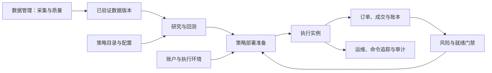

# 量化交易管理后台重构 RFC

日期：2026-11-16

状态：设计基线；尚未替换现有前端，尚未部署。

范围：面向重构后的统一交易栈，重新组织管理后台及其扩展边界。数据管理、风险控制均为一级模块。

## 1. 要解决的问题

当前前端仍围绕旧 StrategyRunner 的页面和生命周期组织。用户点击部署会调用
`POST /v1/strategies/{id}/load`，而新 Control API 明确返回
`LEGACY_STRATEGY_LIFECYCLE_RETIRED`。同时，服务器的分支预览没有 Execution，
网页可访问和容器 healthy 并不能证明账户可连接、策略可运行。

本次不是对旧按钮逐个打补丁，也不是仅更换视觉主题。目标是建立一个有明确领域边界、
真实状态语义和接口契约的工作台，后续增加策略、数据源和风控能力时不再堆叠孤立页面。
可靠的认证、HTTP 客户端、基础组件和现有依赖可以复用；旧页面的业务假设不能直接继承。

成功标准：

- 用户始终知道自己在查看哪个环境、账户、策略实例，以及数据何时更新。
- 展示“进程在线”“网络可达”“账户同步”“交易就绪”各自的事实，不能相互替代。
- 新主导航没有通往退休写接口的操作；旧深链接提供明确迁移落点。
- 数据从采集到可用于回测的全过程可追溯；风险从观察到命令确认的全过程可解释。
- 未提供或未接通的后端能力明确显示原因，不用虚构数据、零值或假成功补齐界面。
- 一个新功能可按模块注册并接受相同的契约、状态、错误和测试规范。

## 2. 产品边界

首要用户是系统拥有者和量化研究/运行人员，优先支持单部署、单账户的真实工作流。
多账户导航预留数据结构，但后端只有一个配置账户时，不能显示可任意切换的账户选择器。
当前重点是 Binance Spot Demo；其他交易所、衍生品、生产实盘不因为出现导航项而视为已支持。

Preview / Demo / Live 是部署与执行环境；Research 是工作域，不与环境混为一个选择器。
环境身份来自后端可信元数据。无法确认时显示“环境未确认”，禁止新增风险操作；
不能根据主机名、URL 或前端下拉框自行认定为 Demo。

本设计不要求重启现有服务、创建新 24h 窗口或进行真实账户交易。

## 3. 信息架构

采用八个一级工作域，避免历史导航中 Data、Research Data、Backtests 等平级重复入口。
以下为目标路由；存在缺口的功能不是当前接口承诺。

| 一级模块 | 主要页面 | 业务对象与核心问题 | 目标路由 |
|---|---|---|---|
| 运行总览 | 系统就绪、待处理异常、任务与命令摘要 | 现在能做什么，什么在阻止运行？ | `/overview` |
| 账户与连接 | 账户、执行实例、会话与同步状态 | 当前账户由谁执行，私有流和对账是否可靠？ | `/accounts` |
| 策略管理 | 策略目录、参数与版本、运行实例、部署准备 | 用什么策略、什么配置、在哪个账户运行？ | `/strategies` |
| 交易与资产 | 订单、成交、持仓、账本与资金划拨 | 发生了什么，资产和预约如何归属？ | `/trading` |
| **数据管理** | 数据源、采集任务、数据集、质量与血缘 | 数据从哪里来，是否完整，能否用于研究？ | `/data` |
| 研究与回测 | 研究方案、回测任务、结果、比较 | 哪个策略版本在什么数据上得到什么结果？ | `/research` |
| **风险控制** | 风险概览、有效限额、阻断原因、紧急控制 | 允许承担多少风险，限制是否真实生效？ | `/risk` |
| 运维与审计 | 服务健康、告警、备份证据、发布身份、操作记录 | 故障在哪里，谁做过什么，证据是否仍有效？ | `/operations` |

AI 功能后续作为研究域内的建议工具，不进入核心导航的交易操作路径，不拥有自动交易权限。
报表分别归入其来源领域；跨域报告成熟后再抽取，首版不增加独立报表平台。

### 全局框架

- 顶部：部署环境、账户上下文、交易就绪状态、最近更新、登录身份。
- 左侧：八个工作域；域内用二级导航。当前域和当前对象始终可见。
- 工作区：标题与状态说明 → 筛选 → 主表/图 → 详情与证据。
- 详情：对象概览、相关记录、状态历史；支持可分享的稳定 URL。
- 命令跟踪：最近提交命令及结果，跨页面仍可找回，不依赖短暂 toast。
- 移动端：抽屉导航、单列详情、表格局部滚动；关键风险操作不能挤成无说明图标。



## 4. 数据管理：一级模块

### 页面与模型

| 页面 | 核心字段 | 操作与限制 |
|---|---|---|
| 数据源 | venue、market、环境、数据类型、可用时间范围、观测时间 | 公共历史数据源与交易账户连接分开，不要求用户填写交易 API Key |
| 采集任务 | job_id、来源、币对、周期、区间、状态、进度、错误、尝试次数 | 创建、查看、受支持的重试；取消/暂停/调度只有契约落地后开放 |
| 数据集目录 | dataset_id、版本/哈希、来源、schema、覆盖区间、行数、更新时间 | 筛选、查看、选择进入研究；不把“文件存在”认定为可回测 |
| 数据质量 | 完整性、缺口、重复、排序、时间边界、异常 OHLCV、校验时间 | 区分已检查、失败、尚未检查；没有质量证据时显示“未验证” |
| 版本与血缘 | 采集任务 → 数据集版本 → 研究快照 → 回测 run | 结果绑定不可变数据身份；修复数据生成新版本，不覆盖既有研究证据 |

### 状态与流程

采集任务状态直接使用 API 枚举，经适配器映射为中文。目录、质量和研究资格是不同维度：

1. 创建历史采集任务，返回任务 ID；提交成功不等于下载完成。
2. 查询任务与数据集产物，展示失败原因及可重试条件。
3. 查询覆盖与质量证据；不在浏览器里用 min/max 时间跨度推断区间连续。
4. 将符合后端资格判定的数据版本用于研究，保存身份和来源关联。
5. 回测详情可反查数据身份与来源；资格缺失时解释阻断，不能跳过检查。

新界面首先接入持久的 history jobs/datasets 与 research datasets。现有
`/v1/data/catalog`、OHLCV worker 和历史数据存储不假定天然共享同一数据身份，
在确认存储、资格桥接和运行时装配前，不把它们合并成一个“全部就绪”的目录。

首版不实现数据删除、任意文件上传、定时调度平台或数据湖；已有导入能力只有经过
格式、大小、来源和资格契约核验后才提供入口。质量修复、校验明细和完整血缘 API
未具备时，保留模型与只读说明，不能编造质量百分比。

## 5. 风险控制：一级模块

### 页面与模型

| 页面 | 展示重点 | 必须说明的边界 |
|---|---|---|
| 风险总览 | 账户/策略 book 的余额、持仓、预约、敞口、阻断原因、估值新鲜度 | 缺失估值不计为零；数据过期不显示安全 |
| 有效限额 | 当前执行端采用的策略、作用范围、版本、实例与生效时间 | “已保存的配置”与“执行端生效的配置”是两件事 |
| 交易门禁 | 账户对账、私有流覆盖、执行租约、行情新鲜度、DR 证据 | 有 REST 200 或 socket 连接不能直接变为 READY |
| 异常与对账 | 未解决项、冲突、未知订单、关联订单与事实证据 | 不能提供无证据的一键清除/忽略 |
| 紧急控制 | 阻止新增风险、撤销活动订单、受控恢复 | 不承诺“按钮按下即停机/清仓”；动作边界明确 |
| 风险操作记录 | 操作者、账户、命令 ID、请求时间、执行结果、拒绝原因 | 受理、执行、交易所完成三者不可混同 |

当前统一准入的权威是 `SpotRiskEngine` 及 Execution 装配的 `RiskPolicy`。
历史 `/v1/risk/limits` 的配置记录以及 crypto risk manager 不是已证明生效的统一
SpotRiskEngine 限额。新后台不得把这类保存成功显示为“交易限额已生效”。
需要后端补充有效策略身份/版本读取及安全更新协议后，才开放在线修改。

### 操作语义

- `BLOCK_NEW_RISK`：阻止新增风险；不表述为清仓或停止全部进程。
- `CANCEL_ALL`：提交撤单意图，持续跟踪父命令和相关订单；存在 UNKNOWN 时不能显示全部撤销。
- `RESUME_NEW_RISK`：仅解除人工阻断，不覆盖私有流、对账、租约、估值或 DR 的其他阻断。
- `RESOLVE`：只有后端明确允许的 code 与证据契约才能开放；首版不做通用 JSON 解锁入口。
- 展示范围、影响、当前环境与账户；高风险操作保留确认和原因记录。
- 不提供自动平仓或浏览器直接调用交易所的捷径。

浏览器超时后按原 command_id 查询回执，不自动生成新 ID 重发风险操作。
`QUEUED` 显示“已受理，待执行”；仅权威状态确认后才显示生效。
UNKNOWN 是待调查状态；FAILED 与拒绝原因需要持久可查。

## 6. 策略与运行的正确边界

分开表示四种对象：

1. **策略定义**：已安装模块、入口、参数 schema、代码身份。
2. **研究方案**：策略配置、数据版本、成本假设、结果。
3. **部署意图**：目标账户、symbols、book、策略版本、参数、预热和风险配置。
4. **运行实例**：Execution 身份、租约、运行状态、实际配置、就绪与错误。

当前后端通过环境配置并重启 Execution 装配策略，没有浏览器动态加载协议。
首版策略目录与运行观察可对接真实读接口；“创建部署”应进入部署准备，
明确列出所缺条件，不能调用旧 `/load`。准备配置不等于部署成功。

浏览器自助部署需要后续独立实现并验收：允许的模块目录、参数校验、配置版本、
账户独占、风险验证、部署命令、操作审计、受控进程应用以及失败回滚。
Control 不持有交易所秘密，不接入 Docker socket，不通过网页传入任意 Python 模块或 shell 命令。
这属于真实后端能力缺口，不能用重写前端掩盖。

## 7. 前端工程框架

保留当前 React / TypeScript / Vite / Router / TanStack Query / Zod / Vitest，
不引入微前端、新状态管理平台或第二套后端。新页面按领域组织，逐域替换旧页面，
不以旧 `pages/` 的目录结构决定新业务边界。

```text
src/
  app/                 # 路由、登录边界、上下文、全局布局、模块注册
  modules/
    overview/
    accounts/
    strategies/
    trading/
    data/
    research/
    risk/
    operations/
  shared/
    api/               # 会话、CSRF、错误、请求关联
    contracts/         # 权威 DTO 的 Zod schema
    commands/          # 幂等 ID、回执查询、状态呈现
    ui/                # 表格、详情、状态、确认、空白与错误
    formatting/        # 金额精度、单位、时区
  tests/               # 跨模块集成、路由与关键用户旅程
```

每个模块拥有 `routes / api / contracts / queries / views / tests`；跨模块不直接读取
另一个页面组件的状态。共享对象只在真实复用出现后上移，首版不建设通用插件加载平台。

核心规范：

- Query key 包含环境、账户和对象身份；切换上下文时取消旧查询、清理旧结果和命令草稿。
- GET 不直接 `as T` 视为可信；响应在 API 边界校验，解析失败显示契约异常。
- 写接口不自动重试；每次明确意图生成一个 ID，重复查询同一回执。
- 金额、数量和价格保留十进制字符串；展示层不以浮点求和生成账户真相。
- 区分对象事实时间、服务端更新时间、浏览器接收时间；时间显示带时区。
- SSE 只在真实已装配的频道上使用；事件失联回退有限频率查询，旧数据标为过期。
- UI 的能力判断改善体验，后端认证、CSRF、授权和风控仍是最终裁决者。
- 禁止通用 `parseActionResult` 把任意 2xx 包装成业务成功。

### 能力与状态模型

能力至少区分：已支持、当前受阻、尚未接入、已退役、权限不足、未知。
静态模块注册表只说明前端实现了什么，不能证明运行环境拥有相应能力。
当前没有统一 capability API 时，按经过核验的部署契约和各接口事实逐项适配；
未来能力接口须明确后端实现，不先写一个不存在的 `/capabilities` 调用。

读状态至少覆盖：加载、空、有效、过期、降级、受阻、失败、契约异常。
错误或未知不能回落为空列表；兼容接口返回的占位零值不能当可用业务事实。
单账户部署不能因兼容接口接受 `account_id` 参数就视为多租户隔离已具备。

## 8. 视觉与交互

采用工作台式信息密度：稳定的导航、明确的对象表格、详情面板和证据链接，
避免首页堆砌无来源的收益卡片和装饰图表。沿用已有语义色，逐步统一设计 token；
不为“重构”同时引入全新组件库。

- 中文界面为主，保留命令 ID、状态码、币对等技术标识，错误附可展开的原始详情。
- 环境标识全局常驻；Live 若未来启用要有明确危险提示，不能只靠红色表达。
- 正文与数字分别设计排版，金额采用等宽数字并显示资产/单位。
- 正常、警告、阻断、未知使用文字与图标共同表达，不仅依赖颜色。
- 全局样式 token 统一间距、密度、色彩、焦点、表格与详情布局。
- 键盘可导航；弹窗管理焦点；状态更新不抢焦点；动画尊重减少动效偏好。

数据管理线框：

```text
数据管理                         [数据源] [采集任务] [数据集] [质量与血缘]
来源 / 市场 / 币对 / 周期 / 时间范围                         [创建采集任务]
----------------------------------------------------------------------
数据集 | 版本 | 实际覆盖 | 最近校验 | 质量状态 | 研究资格 | 操作
----------------------------------------------------------------------
选择对象 -> 来源任务 / 覆盖明细 / 资格原因 / 被哪些回测使用
```

风险控制线框：

```text
风险控制             环境 / 账户 / 执行身份 / 数据时间 / 交易是否就绪
----------------------------------------------------------------------
当前阻断与处置建议              [阻止新增风险] [撤销活动订单]
有效策略与限额 | 资产及预约 | 未决订单与对账 | 命令与审计
----------------------------------------------------------------------
操作 -> 影响确认 -> 命令编号 -> 待执行 -> 确认 / 失败 / 未知与调查
```

## 9. 迁移与验收顺序

| 交付阶段 | 交付物 | 验收门槛 |
|---|---|---|
| 基础框架 | 新导航、上下文、认证、API 契约、能力与状态组件 | 无退休接口调用；未知环境不放开写；移动端/键盘可用 |
| 数据与研究闭环 | 持久采集任务、目录、资格、回测与结果追溯 | 真实 job/dataset/run 关联；不完整数据不能进入运行；重试/失败可见 |
| 风险与交易闭环 | 权威风险读、订单、命令追踪、确认流程 | QUEUED 不假成功；未知和过期不变绿；撤单仍服从后端策略 |
| 策略与 Demo 运行 | 配置/实例模型；补齐部署后端后接入 | 真实 Demo 账户同步、单实例、预热、策略状态、订单/事件证据 |
| 运维与退役 | 发布/DR/告警/审计；删除不再使用的旧模块 | 旧路由有迁移落点；无旧写链；同提交前后端及服务器验收 |

阶段名不是新 Task ID，也不要求重复获得用户已给出的实现授权。
每阶段只有必要的实现、独立测试和 fresh review；父核验后提交。
旧客户端在新版稳定且路由迁移测试通过后删除，不在启动时同时装配两套业务入口。

服务器现有预览保持原样，直到新前端和对应接口共同验收。静态页面、mock 单测或
浏览器返回 200 都不能替代用户旅程验收。合并 main 的既有授权仍以实际 CI 与试运行通过为前提。

### 必测用户旅程

1. 登录 → 识别环境与账户 → 看懂为何不可交易。
2. 创建采集任务 → 查看进度/失败 → 找到数据集 → 读取研究资格 → 提交回测。
3. 查看持仓和预约 → 定位风险阻断 → 发出阻止新增风险命令 → 跟踪执行结果。
4. 网络中断/401/错误 DTO → 显示失联或错误 → 不误报空数据和 READY。
5. 双击提交/响应丢失 → 同一命令身份可追踪，无隐式重复下单或重复控制。
6. 浏览旧策略部署地址 → 获得迁移说明，不再请求退役写接口。
7. 前端显示的有效限额与运行端真正采用的配置一致；未提供生效证据时明确不可确认。
8. 同一提交在服务器的功能验收；Demo 执行验收与纯预览验收分开记录。

## 10. 实施前必须保留的缺口

- 浏览器策略生命周期/部署协调尚无新栈协议。
- 有效 RiskPolicy 的在线读取、版本和应用确认不足；历史配置接口不能替代。
- 历史数据、研究数据与 feature store 的身份/资格映射需逐接口验证。
- broker `connected` 在兼容视图中来自 runtime readiness，不是独立网络状态。
- 部分审计/监控/报表接口依赖运行时装配或兼容占位，必须核实才能纳入正式页面。
- 账户和环境身份、权限、分页、流式更新按现有实际能力接入；多账户/RBAC 不假称完成。

这些缺口应进入后端协同清单，不用前端 mock 或恢复旧栈填补。

## 11. 后端能力核查快照

只读核查确认：统一 Control API 已支持认证、单账户交易控制、账户/账本观察、
健康/租约/DR 综合就绪、持久化历史数据任务、合格数据集与回测任务。静态核查不替代
运行实例验证。新后台 MVP 必须以 `/health/trading` 的综合结果作为交易可用性总状态；
`/v1/brokers` 中的 `connected` 只是持久化 runtime 布尔值。

可以直接进入新界面的核心链路：

- 认证与会话；写操作使用 cookie + Origin + CSRF，命令身份来自会话。
- 环境、账户、综合就绪、阻断原因、执行租约与发布身份。
- 账户余额、占用、UNKNOWN、未记账成交、对账时效、books 与正向划拨。
- 订单/成交读取、手工订单与撤单、按 command_id 的命令回执。
- `BLOCK_NEW_RISK`、`RESUME_NEW_RISK`、`CANCEL_ALL`、`RECONNECT`、带证据的 `RESOLVE`。
- 已安装策略目录、只读源码、当前部署观察、warmup/strategy ready 与关联订单事件。
- 历史采集任务/数据集、研究数据集、持久化回测提交/取消/重试和统一账户事件。

不能展示为可用能力的旧界面承诺：

- 旧策略注册、`load/start/stop/pause/resume/unload` 均为 410；策略由 Execution
  环境配置启动。浏览器部署协调需要独立后端协议，不能用旧按钮恢复。
- `/v1/risk/limits`、crypto budget/probe、time-window 更新属于旧或未完整接入执行链路
  的配置面；统一 Spot 执行策略来自 `QTS_RISK_POLICY_JSON`，当前缺少有效策略身份和
  生效确认读取。
- replay/snapshots 是已退役的兼容路由（410、固定空列表或 404），不能视为可用回放能力。
  策略代码保存/debug、旧 backtests/candidates/autopilot、监控规则增删、告警清除、
  账户 CRUD、全量命令列表没有匹配的新栈路由。
- 兼容读中的空列表、固定零、静态质量分、零 tick/minNotional、`live_trading_enabled`
  等占位不能绘成业务事实。KillSwitch level 1/2/3 统一映射为 `BLOCK_NEW_RISK`，
  界面不得声称“只许平仓/完全停机”。

命令语义按下列边界展示：202/QUEUED 是持久化受理；PLACE 的 CONFIRMED 不等于订单成交；
RECONNECT CONFIRMED 后必须重新读取综合就绪；BLOCK 接受即标记，RESUME 由 Execution 消费；
UNKNOWN 可能有交易所副作用，不得换新 command_id 自动重试。SSE 仅作刷新提示，关键事实
仍以查询和权威状态为准。

新框架首个可交付范围因此收敛为：运行总览、交易与资产、策略观察、数据与研究、风险阻断
与命令追踪。完整在线部署、热更新风控配置、绩效报表和实时流式工作台在后端补齐协议前
不开放操作入口。
